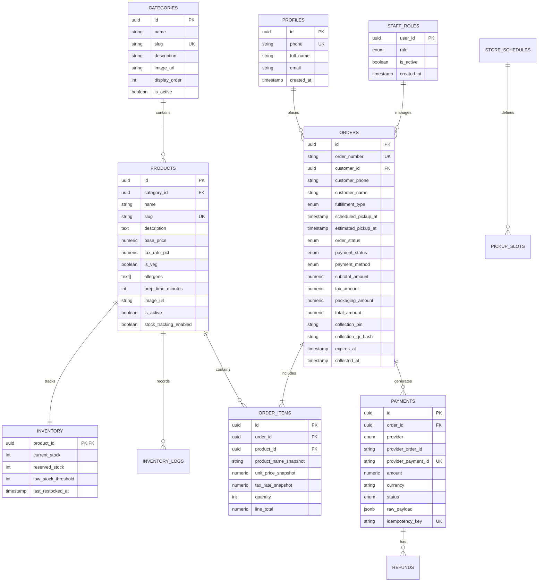

# Moody Orange — Database Architecture & Schema Specification

**Document Version:** 1.0.0  
**Phase:** Phase 0 (Requirements & Architecture)  
**Status:** Pending Client Review & Sign-Off  
**Database Engine:** PostgreSQL 15+ (Hosted on Supabase)  

---

## 1. Schema Design Philosophy

1. **Relational Integrity Over Client Trust:** All entity relationships are enforced via foreign key constraints with explicit `ON DELETE RESTRICT` on business records (orders, payments, inventory) to prevent accidental data loss.
2. **Snapshotting Critical Financial Data:** Item prices, names, and tax rates change over time. Order line items (`order_items`) must snapshot the exact price, tax rate, and product title at the instant of order creation to maintain legal accounting integrity.
3. **Optimistic & Row-Level Locking:** Inventory records utilize explicit row-level locking (`SELECT ... FOR UPDATE`) during atomic checkout transactions to prevent stock overselling under heavy concurrency.
4. **Auditability:** Every stock adjustment, role promotion, order status change, and payment event generates an immutable record in audit/log tables.
5. **UUID Primary Keys:** All tables use cryptographically secure UUIDs (`gen_random_uuid()` or UUIDv7) to prevent enumeration attacks, paired with clean, human-readable external order numbers (e.g., `MO-2610-042`).

---

## 2. Entity-Relationship Model



---

## 3. Data Dictionary & Table Definitions

### 3.1 Custom Enumerated Types (Enums)

```sql
-- Role Hierarchy for Store Staff
CREATE TYPE staff_role_enum AS ENUM (
    'counter_staff',
    'kitchen_staff',
    'manager',
    'admin'
);

-- Fulfillment Timing
CREATE TYPE fulfillment_type_enum AS ENUM (
    'immediate',
    'scheduled'
);

-- Authoritative Order Lifecycle States
CREATE TYPE order_status_enum AS ENUM (
    'draft',              -- Stock reserved, awaiting payment / final placement
    'payment_pending',    -- Payment session initiated with Razorpay
    'confirmed',          -- Confirmed (Paid online or Confirmed Cash)
    'preparing',          -- Kitchen/Counter staff actively assembling
    'ready_for_pickup',   -- Packaged, staged at pickup counter
    'completed',          -- Handed over to customer, collection verified
    'cancelled',          -- Order cancelled by customer or manager
    'expired'             -- Payment window lapsed; stock released
);

-- Payment Settlement States
CREATE TYPE payment_status_enum AS ENUM (
    'unpaid',             -- Applicable to Cash at Pickup orders prior to collection
    'pending',            -- Awaiting gateway webhook / signature
    'authorized',         -- Payment authorized but not yet captured
    'paid',               -- Authoritatively captured
    'failed',             -- Card/UPI declined, timeout, or user aborted
    'refunded'            -- Funds returned to source
);

-- Supported Payment Methods
CREATE TYPE payment_method_enum AS ENUM (
    'online_razorpay',
    'cash_at_pickup'
);

-- Inventory Mutation Reasons
CREATE TYPE inventory_log_reason_enum AS ENUM (
    'order_reservation',
    'order_cancellation_release',
    'order_completion_deduct',
    'reservation_expired_release',
    'manual_restock',
    'manual_adjustment',
    'damaged_spoilage'
);
```

---

### 3.2 Tables & Constraints

#### 1. `profiles`
Links directly to Supabase `auth.users` for authenticated customer accounts.

```sql
CREATE TABLE public.profiles (
    id UUID PRIMARY KEY REFERENCES auth.users(id) ON DELETE CASCADE,
    phone VARCHAR(20) NOT NULL UNIQUE,
    full_name VARCHAR(100),
    email VARCHAR(255),
    created_at TIMESTAMPTZ NOT NULL DEFAULT TIMEZONE('utc', NOW()),
    updated_at TIMESTAMPTZ NOT NULL DEFAULT TIMEZONE('utc', NOW())
);

CREATE INDEX idx_profiles_phone ON public.profiles(phone);
```

#### 2. `staff_roles`
Defines operational permissions for store employees.

```sql
CREATE TABLE public.staff_roles (
    user_id UUID PRIMARY KEY REFERENCES auth.users(id) ON DELETE CASCADE,
    role staff_role_enum NOT NULL DEFAULT 'counter_staff',
    is_active BOOLEAN NOT NULL DEFAULT true,
    assigned_by UUID REFERENCES auth.users(id),
    created_at TIMESTAMPTZ NOT NULL DEFAULT TIMEZONE('utc', NOW()),
    updated_at TIMESTAMPTZ NOT NULL DEFAULT TIMEZONE('utc', NOW())
);
```

#### 3. `categories`
Product classification (Cakes, Juices, Chocolates).

```sql
CREATE TABLE public.categories (
    id UUID PRIMARY KEY DEFAULT gen_random_uuid(),
    name VARCHAR(50) NOT NULL,
    slug VARCHAR(60) NOT NULL UNIQUE,
    description TEXT,
    image_url TEXT,
    display_order INT NOT NULL DEFAULT 0,
    is_active BOOLEAN NOT NULL DEFAULT true,
    created_at TIMESTAMPTZ NOT NULL DEFAULT TIMEZONE('utc', NOW()),
    updated_at TIMESTAMPTZ NOT NULL DEFAULT TIMEZONE('utc', NOW())
);

CREATE INDEX idx_categories_active_order ON public.categories(is_active, display_order);
```

#### 4. `products`
The core catalog item definitions.

```sql
CREATE TABLE public.products (
    id UUID PRIMARY KEY DEFAULT gen_random_uuid(),
    category_id UUID NOT NULL REFERENCES public.categories(id) ON DELETE RESTRICT,
    name VARCHAR(120) NOT NULL,
    slug VARCHAR(140) NOT NULL UNIQUE,
    description TEXT,
    base_price NUMERIC(10, 2) NOT NULL CHECK (base_price >= 0),
    tax_rate_pct NUMERIC(5, 2) NOT NULL DEFAULT 5.00 CHECK (tax_rate_pct >= 0),
    is_veg BOOLEAN NOT NULL DEFAULT true,
    allergens TEXT[] DEFAULT '{}',
    prep_time_minutes INT NOT NULL DEFAULT 15 CHECK (prep_time_minutes >= 0),
    image_url TEXT,
    is_active BOOLEAN NOT NULL DEFAULT true,
    stock_tracking_enabled BOOLEAN NOT NULL DEFAULT true,
    created_at TIMESTAMPTZ NOT NULL DEFAULT TIMEZONE('utc', NOW()),
    updated_at TIMESTAMPTZ NOT NULL DEFAULT TIMEZONE('utc', NOW())
);

CREATE INDEX idx_products_category ON public.products(category_id) WHERE is_active = true;
CREATE INDEX idx_products_slug ON public.products(slug);
```

#### 5. `inventory`
Tracks stock levels atomically.

```sql
CREATE TABLE public.inventory (
    product_id UUID PRIMARY KEY REFERENCES public.products(id) ON DELETE RESTRICT,
    current_stock INT NOT NULL DEFAULT 0 CHECK (current_stock >= 0),
    reserved_stock INT NOT NULL DEFAULT 0 CHECK (reserved_stock >= 0),
    low_stock_threshold INT NOT NULL DEFAULT 3 CHECK (low_stock_threshold >= 0),
    last_restocked_at TIMESTAMPTZ,
    updated_at TIMESTAMPTZ NOT NULL DEFAULT TIMEZONE('utc', NOW()),
    -- Ensures available stock (current_stock - reserved_stock) cannot be negative
    CONSTRAINT chk_stock_availability CHECK (current_stock >= reserved_stock)
);
```

#### 6. `inventory_logs`
Immutable ledger tracking all stock increments, decrements, and reservations.

```sql
CREATE TABLE public.inventory_logs (
    id UUID PRIMARY KEY DEFAULT gen_random_uuid(),
    product_id UUID NOT NULL REFERENCES public.products(id) ON DELETE RESTRICT,
    change_qty INT NOT NULL,
    previous_current_stock INT NOT NULL,
    new_current_stock INT NOT NULL,
    previous_reserved_stock INT NOT NULL,
    new_reserved_stock INT NOT NULL,
    reason inventory_log_reason_enum NOT NULL,
    reference_id UUID, -- Links to order_id or staff user_id
    notes TEXT,
    created_at TIMESTAMPTZ NOT NULL DEFAULT TIMEZONE('utc', NOW())
);

CREATE INDEX idx_inv_logs_product_date ON public.inventory_logs(product_id, created_at DESC);
```

#### 7. `orders`
The central order ledger.

```sql
CREATE TABLE public.orders (
    id UUID PRIMARY KEY DEFAULT gen_random_uuid(),
    order_number VARCHAR(30) NOT NULL UNIQUE,
    customer_id UUID NOT NULL REFERENCES auth.users(id) ON DELETE RESTRICT,
    customer_phone VARCHAR(20) NOT NULL,
    customer_name VARCHAR(100) NOT NULL,
    fulfillment_type fulfillment_type_enum NOT NULL DEFAULT 'immediate',
    scheduled_pickup_at TIMESTAMPTZ,
    estimated_pickup_at TIMESTAMPTZ NOT NULL,
    order_status order_status_enum NOT NULL DEFAULT 'draft',
    payment_status payment_status_enum NOT NULL DEFAULT 'pending',
    payment_method payment_method_enum NOT NULL,
    subtotal_amount NUMERIC(10, 2) NOT NULL CHECK (subtotal_amount >= 0),
    tax_amount NUMERIC(10, 2) NOT NULL DEFAULT 0.00 CHECK (tax_amount >= 0),
    packaging_amount NUMERIC(10, 2) NOT NULL DEFAULT 0.00 CHECK (packaging_amount >= 0),
    discount_amount NUMERIC(10, 2) NOT NULL DEFAULT 0.00 CHECK (discount_amount >= 0),
    total_amount NUMERIC(10, 2) NOT NULL CHECK (total_amount >= 0),
    collection_pin VARCHAR(6),
    collection_qr_hash VARCHAR(64),
    special_notes TEXT,
    cancellation_reason TEXT,
    expires_at TIMESTAMPTZ, -- Stock reservation expiry for pending payments
    collected_at TIMESTAMPTZ,
    collected_by_staff_id UUID REFERENCES auth.users(id),
    created_at TIMESTAMPTZ NOT NULL DEFAULT TIMEZONE('utc', NOW()),
    updated_at TIMESTAMPTZ NOT NULL DEFAULT TIMEZONE('utc', NOW()),
    
    CONSTRAINT chk_total_reconciliation 
        CHECK (total_amount = (subtotal_amount + tax_amount + packaging_amount - discount_amount))
);

CREATE INDEX idx_orders_customer ON public.orders(customer_id, created_at DESC);
CREATE INDEX idx_orders_status ON public.orders(order_status, scheduled_pickup_at);
CREATE INDEX idx_orders_collection_pin ON public.orders(collection_pin) WHERE collection_pin IS NOT NULL;
CREATE INDEX idx_orders_expires_at ON public.orders(expires_at) WHERE order_status = 'payment_pending';
```

#### 8. `order_items`
Immutable snapshot of ordered items.

```sql
CREATE TABLE public.order_items (
    id UUID PRIMARY KEY DEFAULT gen_random_uuid(),
    order_id UUID NOT NULL REFERENCES public.orders(id) ON DELETE CASCADE,
    product_id UUID NOT NULL REFERENCES public.products(id) ON DELETE RESTRICT,
    product_name_snapshot VARCHAR(120) NOT NULL,
    unit_price_snapshot NUMERIC(10, 2) NOT NULL CHECK (unit_price_snapshot >= 0),
    tax_rate_snapshot NUMERIC(5, 2) NOT NULL CHECK (tax_rate_snapshot >= 0),
    quantity INT NOT NULL CHECK (quantity > 0),
    line_total NUMERIC(10, 2) NOT NULL CHECK (line_total >= 0),
    created_at TIMESTAMPTZ NOT NULL DEFAULT TIMEZONE('utc', NOW())
);

CREATE INDEX idx_order_items_order ON public.order_items(order_id);
```

#### 9. `payments`
Gateway and cash transaction audit records.

```sql
CREATE TABLE public.payments (
    id UUID PRIMARY KEY DEFAULT gen_random_uuid(),
    order_id UUID NOT NULL REFERENCES public.orders(id) ON DELETE RESTRICT,
    provider VARCHAR(30) NOT NULL, -- 'razorpay' or 'cash_register'
    provider_order_id VARCHAR(100),
    provider_payment_id VARCHAR(100) UNIQUE,
    provider_signature VARCHAR(255),
    amount NUMERIC(10, 2) NOT NULL CHECK (amount > 0),
    currency VARCHAR(3) NOT NULL DEFAULT 'INR',
    status payment_status_enum NOT NULL,
    raw_payload JSONB,
    idempotency_key VARCHAR(100) UNIQUE,
    created_at TIMESTAMPTZ NOT NULL DEFAULT TIMEZONE('utc', NOW()),
    updated_at TIMESTAMPTZ NOT NULL DEFAULT TIMEZONE('utc', NOW())
);

CREATE INDEX idx_payments_order ON public.payments(order_id);
CREATE INDEX idx_payments_provider_id ON public.payments(provider_payment_id);
```

#### 10. `store_schedules` & `pickup_slots`
Configures physical store hours and 15-minute slot quotas.

```sql
CREATE TABLE public.store_schedules (
    id SERIAL PRIMARY KEY,
    day_of_week INT NOT NULL CHECK (day_of_week BETWEEN 0 AND 6), -- 0=Sunday
    open_time TIME NOT NULL,
    close_time TIME NOT NULL,
    slot_interval_minutes INT NOT NULL DEFAULT 15,
    max_orders_per_slot INT NOT NULL DEFAULT 10,
    is_closed BOOLEAN NOT NULL DEFAULT false,
    CONSTRAINT chk_operating_hours CHECK (open_time < close_time)
);
```

#### 11. `audit_logs`
System-wide security and operations audit log.

```sql
CREATE TABLE public.audit_logs (
    id UUID PRIMARY KEY DEFAULT gen_random_uuid(),
    actor_id UUID REFERENCES auth.users(id),
    actor_role VARCHAR(50),
    action VARCHAR(100) NOT NULL,
    entity_type VARCHAR(50) NOT NULL,
    entity_id VARCHAR(100),
    old_values JSONB,
    new_values JSONB,
    ip_address INET,
    created_at TIMESTAMPTZ NOT NULL DEFAULT TIMEZONE('utc', NOW())
);

CREATE INDEX idx_audit_entity ON public.audit_logs(entity_type, entity_id);
CREATE INDEX idx_audit_created ON public.audit_logs(created_at DESC);
```

---

## 4. Row Level Security (RLS) Policies

All tables have RLS enabled (`ALTER TABLE ... ENABLE ROW LEVEL SECURITY;`).

```sql
-- Helper function to check staff status from JWT
CREATE OR REPLACE FUNCTION public.get_staff_role()
RETURNS staff_role_enum AS $$
  SELECT role FROM public.staff_roles 
  WHERE user_id = auth.uid() AND is_active = true;
$$ LANGUAGE sql SECURITY DEFINER STABLE;

-- 1. CATEGORIES & PRODUCTS (Public Catalog)
ALTER TABLE public.categories ENABLE ROW LEVEL SECURITY;
CREATE POLICY "Public categories are viewable by everyone" 
ON public.categories FOR SELECT USING (is_active = true);

CREATE POLICY "Managers can manage categories" 
ON public.categories FOR ALL TO authenticated 
USING (public.get_staff_role() IN ('manager', 'admin'));

ALTER TABLE public.products ENABLE ROW LEVEL SECURITY;
CREATE POLICY "Public products are viewable by everyone" 
ON public.products FOR SELECT USING (is_active = true);

CREATE POLICY "Managers can manage products" 
ON public.products FOR ALL TO authenticated 
USING (public.get_staff_role() IN ('manager', 'admin'));

-- 2. INVENTORY
ALTER TABLE public.inventory ENABLE ROW LEVEL SECURITY;
CREATE POLICY "Public can view inventory availability" 
ON public.inventory FOR SELECT USING (true);

CREATE POLICY "Only staff can update inventory directly" 
ON public.inventory FOR ALL TO authenticated 
USING (public.get_staff_role() IN ('manager', 'admin'));

-- 3. ORDERS
ALTER TABLE public.orders ENABLE ROW LEVEL SECURITY;
CREATE POLICY "Customers can only view their own orders" 
ON public.orders FOR SELECT TO authenticated 
USING (customer_id = auth.uid());

CREATE POLICY "Staff can view all orders" 
ON public.orders FOR SELECT TO authenticated 
USING (public.get_staff_role() IS NOT NULL);

CREATE POLICY "Staff can update order status" 
ON public.orders FOR UPDATE TO authenticated 
USING (public.get_staff_role() IS NOT NULL);

-- Strict rule: Direct client INSERT / DELETE on orders is BLOCKED.
-- Orders must be created strictly through database stored procedures (RPC) called by the server API.

-- 4. ORDER ITEMS
ALTER TABLE public.order_items ENABLE ROW LEVEL SECURITY;
CREATE POLICY "Customers view their own order items" 
ON public.order_items FOR SELECT TO authenticated 
USING (
    EXISTS (SELECT 1 FROM public.orders WHERE orders.id = order_items.order_id AND orders.customer_id = auth.uid())
);

CREATE POLICY "Staff can view all order items" 
ON public.order_items FOR SELECT TO authenticated 
USING (public.get_staff_role() IS NOT NULL);

-- 5. PAYMENTS
ALTER TABLE public.payments ENABLE ROW LEVEL SECURITY;
CREATE POLICY "Customers view payment status for their orders" 
ON public.payments FOR SELECT TO authenticated 
USING (
    EXISTS (SELECT 1 FROM public.orders WHERE orders.id = payments.order_id AND orders.customer_id = auth.uid())
);

CREATE POLICY "Staff can view payments" 
ON public.payments FOR SELECT TO authenticated 
USING (public.get_staff_role() IS NOT NULL);
```

---

## 5. Critical Database Functions & Stored Procedures (RPC)

### 5.1 Atomic Stock Reservation (`rpc_reserve_order_stock`)

```sql
CREATE OR REPLACE FUNCTION public.rpc_reserve_order_stock(
    p_customer_id UUID,
    p_items JSONB, -- Array of {"product_id": "...", "quantity": 2}
    p_fulfillment fulfillment_type_enum,
    p_scheduled_pickup TIMESTAMPTZ,
    p_payment_method payment_method_enum,
    p_special_notes TEXT
)
RETURNS TABLE (
    out_order_id UUID,
    out_order_number VARCHAR,
    out_total_amount NUMERIC,
    out_expires_at TIMESTAMPTZ
) 
LANGUAGE plpgsql
SECURITY DEFINER
AS $$
DECLARE
    v_item RECORD;
    v_product RECORD;
    v_order_id UUID;
    v_order_number VARCHAR;
    v_subtotal NUMERIC(10, 2) := 0;
    v_tax_total NUMERIC(10, 2) := 0;
    v_packaging NUMERIC(10, 2) := 0;
    v_grand_total NUMERIC(10, 2) := 0;
    v_max_prep_time INT := 15;
    v_estimated_pickup TIMESTAMPTZ;
    v_expires_at TIMESTAMPTZ := TIMEZONE('utc', NOW()) + INTERVAL '10 minutes';
    v_customer_phone VARCHAR;
    v_customer_name VARCHAR;
BEGIN
    -- 1. Verify customer profile
    SELECT phone, full_name INTO v_customer_phone, v_customer_name 
    FROM public.profiles WHERE id = p_customer_id;
    
    IF v_customer_phone IS NULL THEN
        RAISE EXCEPTION 'Customer profile must be completed with valid phone number.';
    END IF;

    -- 2. Generate unique order number (e.g. MO-20261030-XXXX)
    v_order_number := 'MO-' || TO_CHAR(NOW(), 'YYYYMMDD') || '-' || LPAD(FLOOR(RANDOM() * 10000)::TEXT, 4, '0');

    -- 3. Lock inventory rows & validate stock
    FOR v_item IN SELECT * FROM jsonb_to_recordset(p_items) AS x(product_id UUID, quantity INT)
    LOOP
        -- Row lock prevents concurrent checkouts from racing
        SELECT p.*, i.current_stock, i.reserved_stock 
        INTO v_product
        FROM public.products p
        JOIN public.inventory i ON i.product_id = p.id
        WHERE p.id = v_item.product_id AND p.is_active = true
        FOR UPDATE OF i;

        IF NOT FOUND THEN
            RAISE EXCEPTION 'Product % is invalid or inactive', v_item.product_id;
        END IF;

        IF (v_product.current_stock - v_product.reserved_stock) < v_item.quantity THEN
            RAISE EXCEPTION 'Insufficient stock for product "%". Only % units available.', 
                v_product.name, (v_product.current_stock - v_product.reserved_stock);
        END IF;

        -- Update reserved stock
        UPDATE public.inventory 
        SET reserved_stock = reserved_stock + v_item.quantity,
            updated_at = TIMEZONE('utc', NOW())
        WHERE product_id = v_item.product_id;

        -- Accumulate totals
        v_subtotal := v_subtotal + (v_product.base_price * v_item.quantity);
        v_tax_total := v_tax_total + ROUND((v_product.base_price * v_item.quantity * (v_product.tax_rate_pct / 100.0)), 2);
        
        IF v_product.prep_time_minutes > v_max_prep_time THEN
            v_max_prep_time := v_product.prep_time_minutes;
        END IF;
    END LOOP;

    -- Calculate pickup estimation
    IF p_fulfillment = 'immediate' THEN
        v_estimated_pickup := TIMEZONE('utc', NOW()) + (v_max_prep_time || ' minutes')::INTERVAL;
    ELSE
        v_estimated_pickup := p_scheduled_pickup;
    END IF;

    v_grand_total := v_subtotal + v_tax_total + v_packaging;

    -- 4. Create draft order
    INSERT INTO public.orders (
        order_number, customer_id, customer_phone, customer_name,
        fulfillment_type, scheduled_pickup_at, estimated_pickup_at,
        order_status, payment_status, payment_method,
        subtotal_amount, tax_amount, packaging_amount, total_amount,
        special_notes, expires_at
    ) VALUES (
        v_order_number, p_customer_id, v_customer_phone, COALESCE(v_customer_name, 'Valued Customer'),
        p_fulfillment, p_scheduled_pickup, v_estimated_pickup,
        'draft', 'pending', p_payment_method,
        v_subtotal, v_tax_total, v_packaging, v_grand_total,
        p_special_notes, v_expires_at
    ) RETURNING id INTO v_order_id;

    -- 5. Insert order item snapshots
    FOR v_item IN SELECT * FROM jsonb_to_recordset(p_items) AS x(product_id UUID, quantity INT)
    LOOP
        SELECT name, base_price, tax_rate_pct INTO v_product
        FROM public.products WHERE id = v_item.product_id;

        INSERT INTO public.order_items (
            order_id, product_id, product_name_snapshot,
            unit_price_snapshot, tax_rate_snapshot, quantity, line_total
        ) VALUES (
            v_order_id, v_item.product_id, v_product.name,
            v_product.base_price, v_product.tax_rate_pct, v_item.quantity,
            ROUND(v_product.base_price * v_item.quantity, 2)
        );
    END LOOP;

    -- Return newly created order details to API
    out_order_id := v_order_id;
    out_order_number := v_order_number;
    out_total_amount := v_grand_total;
    out_expires_at := v_expires_at;
    RETURN NEXT;
END;
$$;
```

---

### 5.2 Expired Stock Release Scheduled Procedure (`rpc_release_expired_reservations`)

To be triggered every minute via `pg_cron` or a Supabase scheduled edge worker.

```sql
CREATE OR REPLACE FUNCTION public.rpc_release_expired_reservations()
RETURNS INT
LANGUAGE plpgsql
SECURITY DEFINER
AS $$
DECLARE
    v_order RECORD;
    v_item RECORD;
    v_count INT := 0;
BEGIN
    FOR v_order IN 
        SELECT id FROM public.orders 
        WHERE order_status IN ('draft', 'payment_pending') 
          AND expires_at < TIMEZONE('utc', NOW())
        FOR UPDATE SKIP LOCKED
    LOOP
        -- Release reserved stock for each item in the expired order
        FOR v_item IN SELECT product_id, quantity FROM public.order_items WHERE order_id = v_order.id
        LOOP
            UPDATE public.inventory
            SET reserved_stock = GREATEST(0, reserved_stock - v_item.quantity),
                updated_at = TIMEZONE('utc', NOW())
            WHERE product_id = v_item.product_id;

            INSERT INTO public.inventory_logs (
                product_id, change_qty, previous_current_stock, new_current_stock,
                previous_reserved_stock, new_reserved_stock, reason, reference_id, notes
            ) VALUES (
                v_item.product_id, v_item.quantity, 0, 0, 0, 0,
                'reservation_expired_release', v_order.id, 'Payment timeout; released back to inventory'
            );
        END LOOP;

        -- Update order status to expired
        UPDATE public.orders 
        SET order_status = 'expired', 
            updated_at = TIMEZONE('utc', NOW()) 
        WHERE id = v_order.id;

        v_count := v_count + 1;
    END LOOP;

    RETURN v_count;
END;
$$;
```
