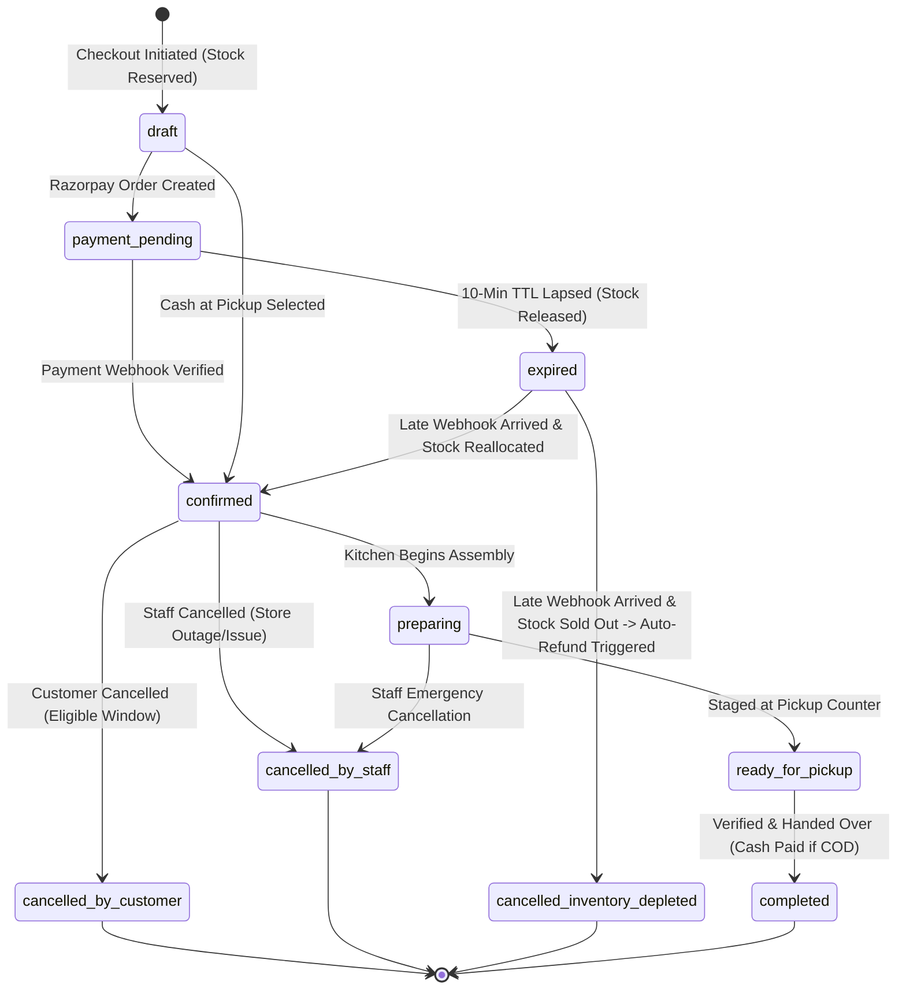

# Moody Orange — Database Architecture & Schema Specification

**Document Version:** 1.1.0 (Phase 0.1 Revision)  
**Phase:** Phase 0 (Requirements & Architecture)  
**Status:** Pending Client Review & Sign-Off  
**Database Engine:** PostgreSQL 15+ (Hosted on Supabase)  
**Repository:** [https://github.com/AbhinavKumar36/orange](https://github.com/AbhinavKumar36/orange)  

---

## Revision History

| Version | Date | Author | Description of Changes |
| :--- | :--- | :--- | :--- |
| **1.0.0** | 2026-10-30 | Lead Architect | Initial schema definitions, tables, and RLS policies. |
| **1.1.0** | 2026-10-30 | Lead Architect | **Phase 0.1 Revision:**<br>• Formalized unambiguous inventory field definitions and mathematical formulas.<br>• Documented complete state transitions for all 10 order and payment lifecycle events.<br>• Added atomic reconciliation procedure for late successful payment webhooks.<br>• Clarified that no customer or staff client holds direct privileged database access. |

---

## 1. Unambiguous Inventory Definitions & Ledger Formulas

To eliminate any ambiguity in stock accounting, the platform defines three distinct stock concepts:

```
+───────────────────────────────────────────────────────────────────────────────+
| DEFINITION 1: current_stock (INTEGER)                                          |
| The total physical count of finished units currently present inside the shop   |
| (on display shelves, in the cake refrigerator, or in the juice chiller).       |
+───────────────────────────────────────────────────────────────────────────────+
| DEFINITION 2: reserved_stock (INTEGER)                                         |
| The count of units that are committed to active transactions:                  |
| 1. Active checkout sessions awaiting payment (locked under a 10-minute TTL).   |
| 2. Confirmed orders (paid online or confirmed cash) awaiting customer pickup.  |
+───────────────────────────────────────────────────────────────────────────────+
| DEFINITION 3: available_stock (COMPUTED FORMULA)                               |
| available_stock = current_stock - reserved_stock                               |
| The net units available for new customers to add to cart and purchase.         |
+───────────────────────────────────────────────────────────────────────────────+
```

### 1.1 Inventory State Transition Rules

| Operational Event | `current_stock` | `reserved_stock` | `available_stock` | Ledger Note |
| :--- | :---: | :---: | :---: | :--- |
| **Initial Restock** (10 units baked) | `+10` | `0` | `+10` | Morning batch entered by manager |
| **Customer Initiates Checkout** (2 units) | `0` | `+2` | `-2` | Atomic row lock (`FOR UPDATE`), 10-min TTL set |
| **Payment Captured Successfully** | `0` | `0` | `0` | Reservation converted to confirmed order |
| **Reservation Expires / Checkout Abandoned** | `0` | `-2` | `+2` | Auto-release procedure returns units to pool |
| **Order Cancelled Before Prep** | `0` | `-2` | `+2` | Units returned to pool |
| **Customer Collects Order at Counter** | `-2` | `-2` | `0` | Physical handover completed; physical stock decremented |
| **Damaged / Spoilage Deduction** (1 unit) | `-1` | `0` | `-1` | Physical write-off logged by manager |

---

## 2. Order & Payment Lifecycle State Machines

### 2.1 Complete Order State Matrix



### 2.2 Lifecycle Transitions Detailed

1. **Stock Reservation:** Triggered at `POST /api/v1/orders/checkout`. Executes `rpc_reserve_order_stock`. Increments `reserved_stock`. Sets `order_status = 'draft'`, `payment_status = 'pending'`, and `expires_at = NOW() + 10 minutes`.
2. **Successful Online Payment:** Triggered by Razorpay `payment.captured` webhook. Signature verified via HMAC-SHA256. Order transitions to `confirmed`. `reserved_stock` remains held.
3. **Failed Payment:** Razorpay webhook `payment.failed` or user abortion. Order transitions to `payment_failed`. Reserved stock is released immediately (`reserved_stock -= qty`).
4. **Expired Reservation:** Customer abandons payment window. After 10 minutes, background procedure `rpc_release_expired_reservations` runs. Order transitions to `expired`. Reserved stock is decremented back to available pool.
5. **Late Successful Payment Webhook (Race Condition):** Customer pays after the 10-minute TTL has lapsed and stock was released.
   - *Case 5A (Stock still available):* System re-locks stock (`reserved_stock += qty`), transitions order to `confirmed`, and alerts kitchen.
   - *Case 5B (Stock sold out to another customer):* System refuses confirmation. Order transitions to `cancelled_inventory_depleted`. Backend automatically initiates full refund via Razorpay Refunds API, transitions `payment_status = 'refunded'`, and notifies customer and store manager.
6. **Duplicate Webhook:** Replay of previously processed webhook. Unique constraint on `payments.provider_payment_id` intercepts the request. System acknowledges with HTTP 200 OK without double-mutating stock or order states.
7. **Payment Reversal or Refund:** Initiated by manager in admin portal or auto-triggered by late webhook. Creates record in `refunds` table, updates order `payment_status = 'refunded'`, releases stock if not prepared, and logs event in `audit_logs`.
8. **Cash-at-Pickup Order:** Order created with `payment_method = 'cash_at_pickup'`. Order transitions immediately to `confirmed` with `payment_status = 'unpaid'`. When collected at counter, staff verifies cash receipt, updating status to `completed` and `payment_status = 'paid'`.
9. **Customer Cancellation:** Permitted only while status is `confirmed` (prior to `preparing`). Reserved stock is released. If paid online, automated refund is scheduled.
10. **Staff Cancellation:** Store manager cancels order due to kitchen ingredient shortage or emergency closure. Reserved stock is adjusted, refund is issued immediately, and customer is notified via SMS/push.

---

## 3. Database Schema Definitions (DDL)

```sql
-- Custom Enumerated Types
CREATE TYPE order_status_enum AS ENUM (
    'draft',
    'payment_pending',
    'confirmed',
    'preparing',
    'ready_for_pickup',
    'completed',
    'expired',
    'cancelled_by_customer',
    'cancelled_by_staff',
    'cancelled_inventory_depleted'
);

CREATE TYPE payment_status_enum AS ENUM (
    'unpaid',
    'pending',
    'paid',
    'failed',
    'refund_pending',
    'refunded'
);

CREATE TYPE payment_method_enum AS ENUM (
    'online_razorpay',
    'cash_at_pickup'
);

CREATE TYPE staff_role_enum AS ENUM (
    'counter_staff',
    'manager',
    'admin'
);

-- 1. PROFILES (Customer Profile bound to Supabase auth.users)
CREATE TABLE public.profiles (
    id UUID PRIMARY KEY REFERENCES auth.users(id) ON DELETE CASCADE,
    phone VARCHAR(20) NOT NULL UNIQUE,
    full_name VARCHAR(100),
    email VARCHAR(255),
    created_at TIMESTAMPTZ NOT NULL DEFAULT TIMEZONE('utc', NOW()),
    updated_at TIMESTAMPTZ NOT NULL DEFAULT TIMEZONE('utc', NOW())
);

-- 2. STAFF ROLES (Server-governed permissions)
CREATE TABLE public.staff_roles (
    user_id UUID PRIMARY KEY REFERENCES auth.users(id) ON DELETE CASCADE,
    role staff_role_enum NOT NULL DEFAULT 'counter_staff',
    is_active BOOLEAN NOT NULL DEFAULT true,
    assigned_by UUID REFERENCES auth.users(id),
    created_at TIMESTAMPTZ NOT NULL DEFAULT TIMEZONE('utc', NOW())
);

-- 3. CATEGORIES
CREATE TABLE public.categories (
    id UUID PRIMARY KEY DEFAULT gen_random_uuid(),
    name VARCHAR(50) NOT NULL,
    slug VARCHAR(60) NOT NULL UNIQUE,
    description TEXT,
    image_url TEXT,
    display_order INT NOT NULL DEFAULT 0,
    is_active BOOLEAN NOT NULL DEFAULT true,
    created_at TIMESTAMPTZ NOT NULL DEFAULT TIMEZONE('utc', NOW())
);

-- 4. PRODUCTS
CREATE TABLE public.products (
    id UUID PRIMARY KEY DEFAULT gen_random_uuid(),
    category_id UUID NOT NULL REFERENCES public.categories(id) ON DELETE RESTRICT,
    name VARCHAR(120) NOT NULL,
    slug VARCHAR(140) NOT NULL UNIQUE,
    description TEXT,
    base_price NUMERIC(10, 2) NOT NULL CHECK (base_price >= 0),
    tax_rate_pct NUMERIC(5, 2) NOT NULL DEFAULT 5.00 CHECK (tax_rate_pct >= 0),
    is_veg BOOLEAN NOT NULL DEFAULT true,
    allergens TEXT[] DEFAULT '{}',
    prep_time_minutes INT NOT NULL DEFAULT 15 CHECK (prep_time_minutes >= 0),
    image_url TEXT,
    is_active BOOLEAN NOT NULL DEFAULT true,
    created_at TIMESTAMPTZ NOT NULL DEFAULT TIMEZONE('utc', NOW()),
    updated_at TIMESTAMPTZ NOT NULL DEFAULT TIMEZONE('utc', NOW())
);

-- 5. INVENTORY (Unambiguous Stock Engine)
CREATE TABLE public.inventory (
    product_id UUID PRIMARY KEY REFERENCES public.products(id) ON DELETE RESTRICT,
    current_stock INT NOT NULL DEFAULT 0 CHECK (current_stock >= 0),
    reserved_stock INT NOT NULL DEFAULT 0 CHECK (reserved_stock >= 0),
    low_stock_threshold INT NOT NULL DEFAULT 3 CHECK (low_stock_threshold >= 0),
    last_restocked_at TIMESTAMPTZ,
    updated_at TIMESTAMPTZ NOT NULL DEFAULT TIMEZONE('utc', NOW()),
    -- Guarantees reserved stock never exceeds physical stock
    CONSTRAINT chk_stock_balance CHECK (current_stock >= reserved_stock)
);

-- 6. ORDERS
CREATE TABLE public.orders (
    id UUID PRIMARY KEY DEFAULT gen_random_uuid(),
    order_number VARCHAR(30) NOT NULL UNIQUE,
    customer_id UUID NOT NULL REFERENCES auth.users(id) ON DELETE RESTRICT,
    customer_phone VARCHAR(20) NOT NULL,
    customer_name VARCHAR(100) NOT NULL,
    fulfillment_type VARCHAR(20) NOT NULL DEFAULT 'immediate',
    scheduled_pickup_at TIMESTAMPTZ,
    estimated_pickup_at TIMESTAMPTZ NOT NULL,
    order_status order_status_enum NOT NULL DEFAULT 'draft',
    payment_status payment_status_enum NOT NULL DEFAULT 'pending',
    payment_method payment_method_enum NOT NULL,
    subtotal_amount NUMERIC(10, 2) NOT NULL CHECK (subtotal_amount >= 0),
    tax_amount NUMERIC(10, 2) NOT NULL DEFAULT 0.00 CHECK (tax_amount >= 0),
    packaging_amount NUMERIC(10, 2) NOT NULL DEFAULT 0.00 CHECK (packaging_amount >= 0),
    total_amount NUMERIC(10, 2) NOT NULL CHECK (total_amount >= 0),
    collection_pin VARCHAR(6),
    collection_qr_hash VARCHAR(64),
    special_notes TEXT,
    cancellation_reason TEXT,
    expires_at TIMESTAMPTZ,
    collected_at TIMESTAMPTZ,
    collected_by_staff_id UUID REFERENCES auth.users(id),
    created_at TIMESTAMPTZ NOT NULL DEFAULT TIMEZONE('utc', NOW()),
    updated_at TIMESTAMPTZ NOT NULL DEFAULT TIMEZONE('utc', NOW())
);

CREATE INDEX idx_orders_customer ON public.orders(customer_id, created_at DESC);
CREATE INDEX idx_orders_status ON public.orders(order_status, scheduled_pickup_at);
CREATE INDEX idx_orders_expires_at ON public.orders(expires_at) WHERE order_status IN ('draft', 'payment_pending');

-- 7. ORDER ITEMS (Immutable Financial Snapshot)
CREATE TABLE public.order_items (
    id UUID PRIMARY KEY DEFAULT gen_random_uuid(),
    order_id UUID NOT NULL REFERENCES public.orders(id) ON DELETE CASCADE,
    product_id UUID NOT NULL REFERENCES public.products(id) ON DELETE RESTRICT,
    product_name_snapshot VARCHAR(120) NOT NULL,
    unit_price_snapshot NUMERIC(10, 2) NOT NULL CHECK (unit_price_snapshot >= 0),
    tax_rate_snapshot NUMERIC(5, 2) NOT NULL CHECK (tax_rate_snapshot >= 0),
    quantity INT NOT NULL CHECK (quantity > 0),
    line_total NUMERIC(10, 2) NOT NULL CHECK (line_total >= 0),
    created_at TIMESTAMPTZ NOT NULL DEFAULT TIMEZONE('utc', NOW())
);

-- 8. PAYMENTS (Gateway Audit Records)
CREATE TABLE public.payments (
    id UUID PRIMARY KEY DEFAULT gen_random_uuid(),
    order_id UUID NOT NULL REFERENCES public.orders(id) ON DELETE RESTRICT,
    provider VARCHAR(30) NOT NULL,
    provider_order_id VARCHAR(100),
    provider_payment_id VARCHAR(100) UNIQUE,
    provider_signature VARCHAR(255),
    amount NUMERIC(10, 2) NOT NULL CHECK (amount > 0),
    currency VARCHAR(3) NOT NULL DEFAULT 'INR',
    status payment_status_enum NOT NULL,
    raw_payload JSONB,
    created_at TIMESTAMPTZ NOT NULL DEFAULT TIMEZONE('utc', NOW())
);

CREATE INDEX idx_payments_order ON public.payments(order_id);
CREATE INDEX idx_payments_provider_id ON public.payments(provider_payment_id);

-- 9. REFUNDS
CREATE TABLE public.refunds (
    id UUID PRIMARY KEY DEFAULT gen_random_uuid(),
    payment_id UUID NOT NULL REFERENCES public.payments(id) ON DELETE RESTRICT,
    order_id UUID NOT NULL REFERENCES public.orders(id) ON DELETE RESTRICT,
    provider_refund_id VARCHAR(100) UNIQUE,
    amount NUMERIC(10, 2) NOT NULL CHECK (amount > 0),
    status VARCHAR(30) NOT NULL DEFAULT 'processed',
    reason TEXT NOT NULL,
    created_at TIMESTAMPTZ NOT NULL DEFAULT TIMEZONE('utc', NOW())
);

-- 10. AUDIT LOGS (Immutable Security Ledger)
CREATE TABLE public.audit_logs (
    id UUID PRIMARY KEY DEFAULT gen_random_uuid(),
    actor_id UUID REFERENCES auth.users(id),
    actor_role VARCHAR(50),
    action VARCHAR(100) NOT NULL,
    entity_type VARCHAR(50) NOT NULL,
    entity_id VARCHAR(100),
    old_values JSONB,
    new_values JSONB,
    ip_address INET,
    created_at TIMESTAMPTZ NOT NULL DEFAULT TIMEZONE('utc', NOW())
);
```

---

## 4. Row Level Security (RLS) & Access Boundaries

Row Level Security is enabled on every table (`ALTER TABLE ... ENABLE ROW LEVEL SECURITY;`).

> [!IMPORTANT]
> **No client application—neither Customer Web, Android App, nor Admin Web—receives direct privileged database access.**  
> • Public catalog read access uses the Supabase Anon Key guarded by RLS.  
> • All mutations to `orders`, `inventory`, and `payments` are blocked from direct client execution and must route through `apps/backend-api`, which connects using the isolated Service Role key to execute secured stored procedures.

```sql
-- Role helper function
CREATE OR REPLACE FUNCTION public.get_staff_role()
RETURNS staff_role_enum AS $$
  SELECT role FROM public.staff_roles 
  WHERE user_id = auth.uid() AND is_active = true;
$$ LANGUAGE sql SECURITY DEFINER STABLE;

-- Public Catalog Read Access
CREATE POLICY "Public categories are viewable" ON public.categories FOR SELECT USING (is_active = true);
CREATE POLICY "Public products are viewable" ON public.products FOR SELECT USING (is_active = true);
CREATE POLICY "Public inventory availability is viewable" ON public.inventory FOR SELECT USING (true);

-- Customer Data Isolation
CREATE POLICY "Customers view own orders" ON public.orders FOR SELECT TO authenticated USING (customer_id = auth.uid());
CREATE POLICY "Customers view own order items" ON public.order_items FOR SELECT TO authenticated 
USING (EXISTS (SELECT 1 FROM public.orders WHERE orders.id = order_items.order_id AND orders.customer_id = auth.uid()));

-- Staff Read Access
CREATE POLICY "Staff view all orders" ON public.orders FOR SELECT TO authenticated USING (public.get_staff_role() IS NOT NULL);
CREATE POLICY "Staff view order items" ON public.order_items FOR SELECT TO authenticated USING (public.get_staff_role() IS NOT NULL);

-- Block Direct Client Writes
CREATE POLICY "Deny direct client order insertion" ON public.orders FOR INSERT WITH CHECK (false);
CREATE POLICY "Deny direct client order updates" ON public.orders FOR UPDATE USING (false);
CREATE POLICY "Deny direct client inventory modification" ON public.inventory FOR UPDATE USING (false);
```

---

## 5. Critical Database Stored Procedures (RPCs)

### 5.1 Late Webhook Reconciliation (`rpc_reconcile_late_payment`)

Handles the critical race condition where payment arrives after the reservation has expired:

```sql
CREATE OR REPLACE FUNCTION public.rpc_reconcile_late_payment(
    p_order_id UUID,
    p_provider_payment_id VARCHAR,
    p_amount NUMERIC,
    p_raw_payload JSONB
)
RETURNS TABLE (
    out_action VARCHAR, -- 'CONFIRMED_REALLOCATED' or 'TRIGGER_REFUND'
    out_order_status order_status_enum
)
LANGUAGE plpgsql
SECURITY DEFINER
AS $$
DECLARE
    v_order RECORD;
    v_item RECORD;
    v_can_allocate BOOLEAN := true;
BEGIN
    -- 1. Lock target order
    SELECT * INTO v_order FROM public.orders WHERE id = p_order_id FOR UPDATE;
    
    IF NOT FOUND THEN
        RAISE EXCEPTION 'Order % not found', p_order_id;
    END IF;

    -- Record payment record first
    INSERT INTO public.payments (order_id, provider, provider_payment_id, amount, status, raw_payload)
    VALUES (p_order_id, 'razorpay', p_provider_payment_id, p_amount, 'paid', p_raw_payload)
    ON CONFLICT (provider_payment_id) DO NOTHING;

    -- 2. Verify if stock can be re-allocated
    FOR v_item IN SELECT product_id, quantity FROM public.order_items WHERE order_id = p_order_id
    LOOP
        PERFORM 1 FROM public.inventory 
        WHERE product_id = v_item.product_id 
          AND (current_stock - reserved_stock) >= v_item.quantity
        FOR UPDATE;
        
        IF NOT FOUND THEN
            v_can_allocate := false;
            EXIT;
        END IF;
    END LOOP;

    -- 3. Branch: Reallocate OR Trigger Refund
    IF v_can_allocate THEN
        -- Re-reserve stock
        FOR v_item IN SELECT product_id, quantity FROM public.order_items WHERE order_id = p_order_id
        LOOP
            UPDATE public.inventory 
            SET reserved_stock = reserved_stock + v_item.quantity 
            WHERE product_id = v_item.product_id;
        END LOOP;

        UPDATE public.orders 
        SET order_status = 'confirmed', payment_status = 'paid', updated_at = NOW() 
        WHERE id = p_order_id;

        out_action := 'CONFIRMED_REALLOCATED';
        out_order_status := 'confirmed';
    ELSE
        -- Inventory is depleted; mark for automated refund
        UPDATE public.orders 
        SET order_status = 'cancelled_inventory_depleted', 
            payment_status = 'refund_pending', 
            cancellation_reason = 'Payment received after reservation expired; stock depleted by another order.',
            updated_at = NOW() 
        WHERE id = p_order_id;

        out_action := 'TRIGGER_REFUND';
        out_order_status := 'cancelled_inventory_depleted';
    END IF;

    RETURN NEXT;
END;
$$;
```
