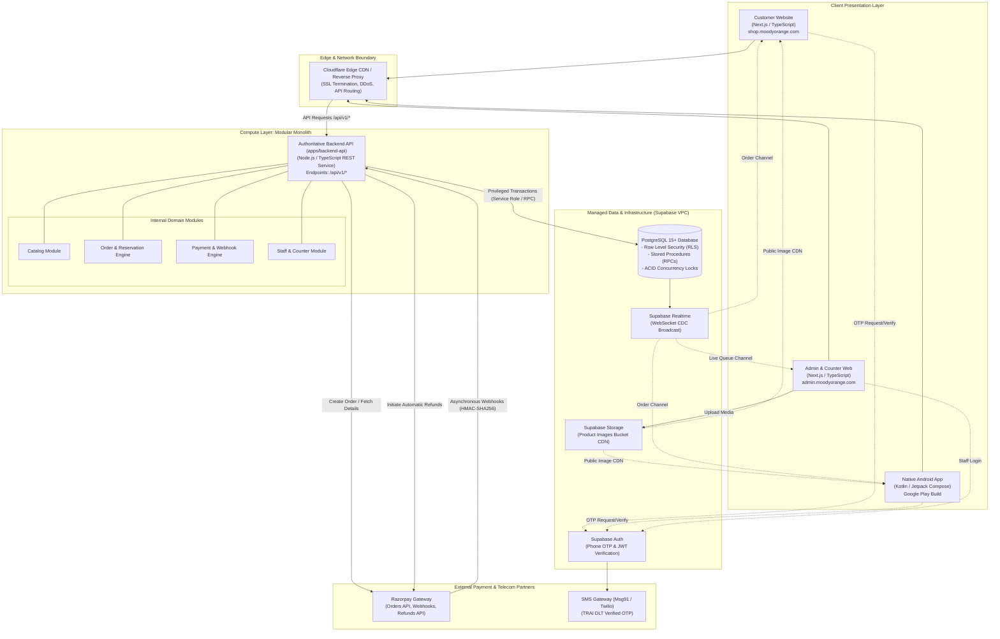
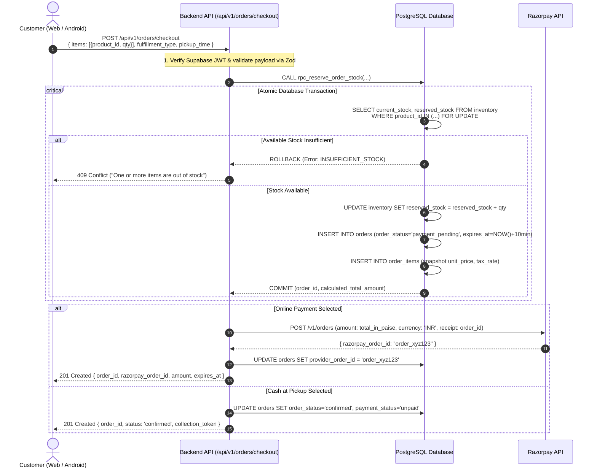
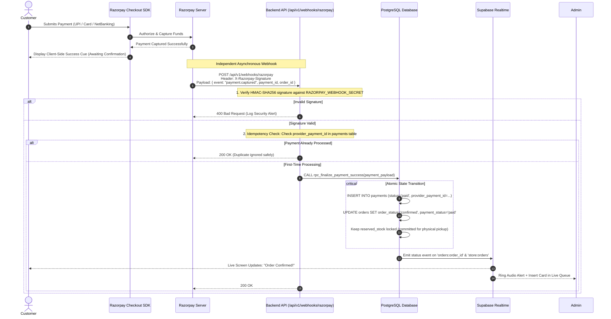
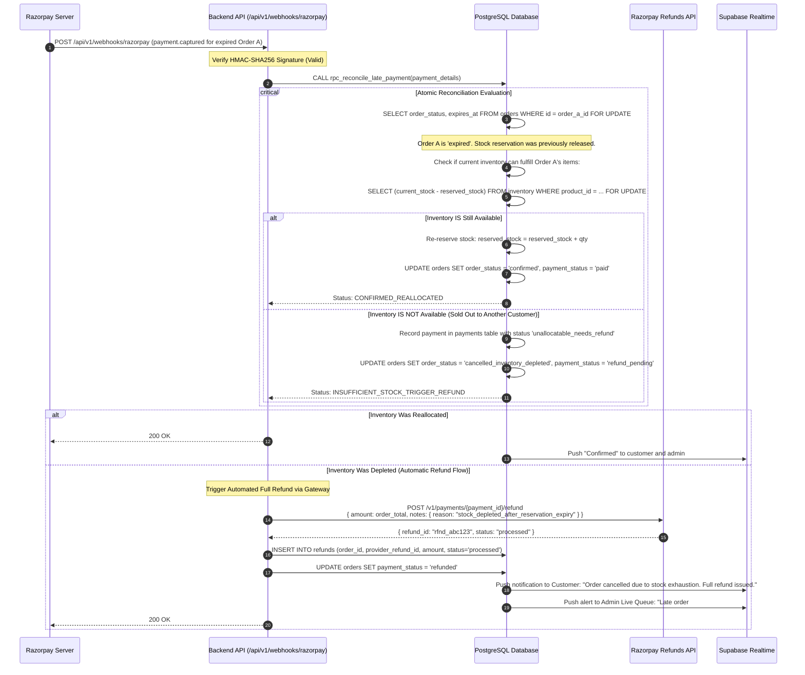
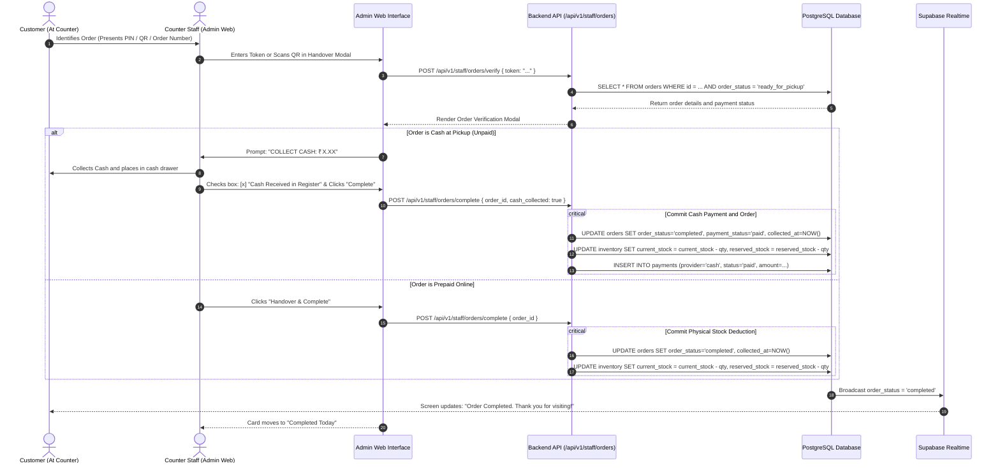

# Moody Orange — System Architecture Specification

**Document Version:** 1.1.0 (Phase 0.1 Revision)  
**Phase:** Phase 0 (Requirements & Architecture)  
**Status:** Pending Client Review & Sign-Off  
**Target System:** Moody Orange Unified Ordering Platform  
**Repository:** [https://github.com/AbhinavKumar36/orange](https://github.com/AbhinavKumar36/orange)  

---

## Revision History

| Version | Date | Author | Description of Changes |
| :--- | :--- | :--- | :--- |
| **1.0.0** | 2026-10-30 | Lead Architect | Initial architectural proposal with API embedded in Customer Next.js app. |
| **1.1.0** | 2026-10-30 | Lead Architect | **Phase 0.1 Revision:**<br>• Decoupled Backend API into an independent practical modular monolith (`apps/backend-api`).<br>• Evaluated modular monolith vs. microservices vs. embedded architectures with trade-offs.<br>• Added explicit data flow and automated reconciliation for late payment webhooks.<br>• Classified requirements and clarified client vs. backend boundaries. |

---

## 1. Architectural Strategy & Evaluation

### 1.1 Core Architectural Principles
1. **Single Authoritative Source of Truth:** `[CONFIRMED]` All business calculations, price determinations, stock balances, tax calculations, and order state progressions are enforced strictly on the server and database. Client applications are presentation layers with zero authority to dictate prices or stock.
2. **Zero-Trust Client Inputs:** `[CONFIRMED]` The backend never accepts client-calculated totals or arbitrary payment confirmation signals.
3. **Atomic Concurrency Guarantee:** `[CONFIRMED]` Inventory reservations use strict row-level locking (`SELECT ... FOR UPDATE`) in PostgreSQL to guarantee that race conditions and overselling cannot occur.
4. **Asynchronous Webhook-First Settlement:** `[CONFIRMED]` Payment capture is confirmed exclusively via cryptographically signed webhooks and direct server-to-gateway verification, never client-side redirects alone.
5. **Independent Backend Separation:** `[CONFIRMED ARCHITECTURE]` The backend API is logically and deployably independent from both the customer-facing and admin-facing web applications.

---

### 1.2 Evaluation of Backend Topology: Modular Monolith vs. Alternatives

To fulfill the requirement that Customer Web, Admin Web, and Native Android App consume the **exact same authoritative backend contracts and business rules**, three architecture patterns were evaluated:

```
+───────────────────────────────────────────────────────────────────────────────+
| PATTERN A: Embedded API in Customer Next.js App (PREVIOUS PROPOSAL)          |
| Pros: Low infrastructure count (single web server).                           |
| Cons: Tight coupling. Scaling or deploying customer website restarts backend; |
|       Android app and Admin panel depend on Customer Web deployment stability.|
| Status: REJECTED                                                              |
+───────────────────────────────────────────────────────────────────────────────+

+───────────────────────────────────────────────────────────────────────────────+
| PATTERN B: Microservices (Catalog Service, Order Service, Payment Service)     |
| Pros: Independent scaling of individual business domains.                     |
| Cons: Extreme operational complexity, distributed transactions (sagas),        |
|       network latency overhead, multiple CI/CD pipelines, unnecessary for a   |
|       single physical retail store.                                           |
| Status: REJECTED (Unwarranted complexity)                                     |
+───────────────────────────────────────────────────────────────────────────────+

+───────────────────────────────────────────────────────────────────────────────+
| PATTERN C: Practical Modular Monolith Backend API (RECOMMENDED)               |
| Location: apps/backend-api (Node.js / TypeScript REST API)                    |
| Pros:                                                                         |
| • Independently deployable and isolated from frontend web apps.               |
| • Single, authoritative REST API (/api/v1/...) consumed identically by        |
|   Customer Web, Admin Web, and Native Android App.                            |
| • Internal modular domains (Catalog, Orders, Payments, Staff) share a single  |
|   high-performance codebase and single PostgreSQL connection pool.            |
| • Zero distributed transaction overhead; uses Postgres ACID transactions.     |
| Status: ACCEPTED & ADOPTED                                                    |
+───────────────────────────────────────────────────────────────────────────────+
```

---

### 1.3 Technology Stack Evaluation

| Proposed Component | Proposed Usage | Evaluation & Architectural Decision | Status |
| :--- | :--- | :--- | :--- |
| **PostgreSQL 15+** | Relational Database | ACID transactional reliability, row-level locking (`SELECT ... FOR UPDATE`), check constraints, and JSONB audit logging. | `[CONFIRMED]` |
| **Supabase Platform** | Managed BaaS | Managed Postgres, connection pooling (PgBouncer/Supavisor), Auth, Storage, and Realtime out of the box. Direct client mutations to orders/inventory are blocked via RLS. | `[CONFIRMED]` |
| **Standalone Backend API** | Authoritative REST API (`apps/backend-api`) | Node.js/TypeScript modular monolith. Executes Zod input validation, Razorpay SDK operations, webhook verification, and calls PostgreSQL Stored Procedures. | `[CONFIRMED ARCHITECTURE]` |
| **Customer Web** | Customer Storefront (`apps/customer-web`) | Next.js (App Router), TypeScript. Server components for catalog SEO; client components for cart, checkout, and tracking. | `[CONFIRMED]` |
| **Native Android App** | Mobile App (`apps/android`) | 100% Native Kotlin, Jetpack Compose. Zero web wrappers or cross-platform bridges. Consumes `/api/v1/...` REST endpoints. | `[CONFIRMED]` |
| **Admin Web** | Counter Portal (`apps/admin-web`) | Next.js (App Router), TypeScript. Realtime queue board, audio alert integration, PIN/QR collection verification modal. | `[CONFIRMED]` |
| **Razorpay Gateway** | Payment Engine | Indian payment gateway supporting UPI, Cards, NetBanking. HMAC-SHA256 webhook signatures and refund APIs. | `[CONFIRMED]` |

---

## 2. High-Level System Architecture Topology



---

## 3. End-to-End Data Flows

### 3.1 Flow 1: Order Placement & Atomic Stock Reservation



---

### 3.2 Flow 2: Razorpay Asynchronous Webhook & Standard Payment Settlement



---

### 3.3 Flow 2B: Late Webhook Arrival After Reservation Expiry (Critical Edge Case)

This scenario occurs when a customer's payment window lapses, their stock reservation expires, another customer purchases the remaining stock, and Razorpay subsequently delivers a delayed `payment.captured` webhook.



---

### 3.4 Flow 3: Counter Pickup Verification & Order Handover



---

## 4. Subsystem Architectures

### 4.1 Authoritative Backend API (`apps/backend-api`)
- **Runtime:** Node.js LTS (v20+) with TypeScript.
- **Framework Choice:** Fastify or Express (Fastify recommended for low overhead and native JSON schema serialization).
- **Core Responsibilities:**
  - Route Handlers under `/api/v1/` for catalog, cart, checkout, staff verification, and webhooks.
  - Zod validation on every incoming request.
  - Razorpay SDK management (server-only key secrets).
  - PostgreSQL stored procedure invocation using the Supabase Service Role client.

### 4.2 Customer Website (`apps/customer-web`)
- **Framework:** Next.js (App Router), TypeScript, Vanilla CSS / design tokens.
- **Rendering Pattern:**
  - Server-Side Rendering (SSR) & Incremental Static Regeneration (ISR) for fast SEO-indexed catalog browsing.
  - Client components for interactive cart, OTP modal, checkout, and live tracking.
- **Data Fetching:** Direct read queries to Supabase PostgREST for public catalog; all mutations route to `apps/backend-api` at `/api/v1/*`.

### 4.3 Native Android Application (`apps/android`)
- **Technology:** 100% Native Kotlin, Jetpack Compose, Material 3.
- **Architecture:** Clean Architecture + MVI (Model-View-Intent).
- **Networking:** Retrofit2 / OkHttp client consuming `https://api.moodyorange.com/api/v1/`.
- **Data Models:** Authored Kotlin data classes strictly matching the `/api/v1/` REST JSON contracts.
- **Local Persistence:** Jetpack Room for offline catalog caching; DataStore for session tokens.

### 4.4 Admin Counter Website (`apps/admin-web`)
- **Framework:** Next.js (App Router), TypeScript.
- **Layout:** High-density, high-contrast dashboard optimized for 10-inch counter tablets and desktop POS displays.
- **Hardware Integration:** Supports camera-based QR scanning via WebRTC or USB keyboard-wedge barcode scanners.
- **Live Dispatch Queue:** Subscribed to Supabase Realtime WebSocket channel `store:orders`.
