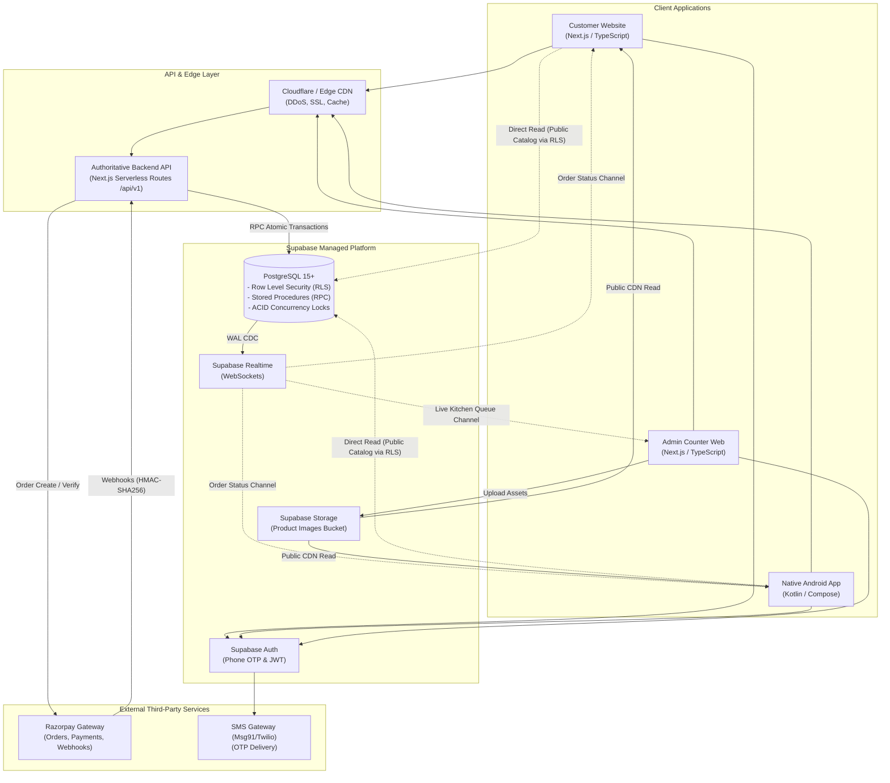
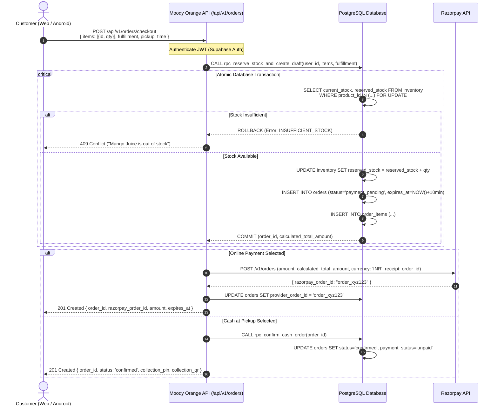
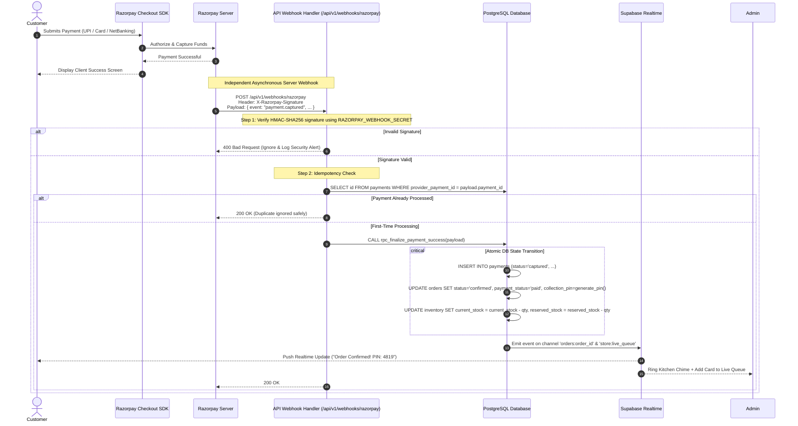

# Moody Orange — System Architecture Specification

**Document Version:** 1.0.0  
**Phase:** Phase 0 (Requirements & Architecture)  
**Status:** Pending Client Review & Sign-Off  
**Target System:** Moody Orange Unified Ordering Platform  

---

## 1. Architectural Principles & Evaluation

### 1.1 Core Architectural Principles
1. **Single Authoritative Source of Truth:** All business rules, price calculations, inventory balances, tax rules, and order state transitions are enforced strictly on the server/database. Client applications are presentation layers and cannot dictate final prices or stock levels.
2. **Zero-Trust Client Inputs:** The backend never accepts client-calculated totals or arbitrary payment confirmation signals.
3. **Atomic Concurrency Guarantee:** Inventory reservations use strict row-level locking (`SELECT ... FOR UPDATE`) in PostgreSQL to guarantee that race conditions and overselling cannot occur.
4. **Asynchronous Webhook-First Settlement:** Payment capture is confirmed exclusively via cryptographically signed webhooks and direct server-to-gateway verification, never client-side redirects alone.
5. **Separation of Read vs. Write Paths:** Public catalog data is optimized for high-speed edge reads, while order placements and financial mutations route through hardened transactional endpoints.

---

### 1.2 Evaluation of Proposed Technology Stack

| Proposed Component | Proposed Usage | Evaluation & Architectural Recommendation | Recommendation Status |
| :--- | :--- | :--- | :--- |
| **PostgreSQL** | Primary Relational DB | **Approved.** Postgres offers world-class ACID transactional reliability, robust concurrency controls (row locks, advisory locks), table constraints, JSONB flexibility, and native UUID/time handling essential for quick-commerce. | **Accepted** |
| **Supabase Platform** | Managed BaaS | **Approved with Boundary Restrictions.** Supabase provides managed Postgres, connection pooling (PgBouncer/Supavisor), Auth, Storage, and Realtime out of the box. **Crucial Architectural Change:** Client apps MUST NOT perform direct writes or updates to `orders`, `inventory`, or `payments` tables via client-side PostgREST. All state mutations must route through server-side API endpoints or secured PostgreSQL Stored Procedures (RPCs). | **Accepted with Constraints** |
| **Supabase Auth** | Mobile Phone OTP & Staff Auth | **Approved.** Supabase Auth natively supports SMS OTP providers (e.g., Twilio, MessageBird, or custom SMS webhooks via providers like Msg91/Fast2SMS in India) and standard Email/Password for Staff. Integrates cleanly with Postgres Row Level Security (`auth.uid()`). | **Accepted** |
| **Supabase Storage** | Product Image CDN | **Approved.** S3-compatible, edge-cached storage. Bucket `product-images` set to Public Read, with Write restricted strictly to authenticated `manager` and `admin` staff roles via RLS. | **Accepted** |
| **Next.js (Customer Web)** | Customer Storefront | **Approved.** Next.js (App Router) provides Server-Side Rendering (SSR) and Incremental Static Regeneration (ISR) for fast SEO-indexed catalog browsing, combined with dynamic React client components for cart, checkout, and live tracking. | **Accepted** |
| **Native Kotlin + Compose** | Android Mobile App | **Approved.** High performance, zero runtime bridge overhead, seamless background notifications, native camera integration for QR scanning, and robust offline caching via Room. | **Accepted** |
| **Next.js (Admin Web)** | Store Counter Portal | **Approved.** Enables rapid operational dashboard development, unified TypeScript types with the customer web, server actions, and native WebSocket integration with Supabase Realtime. | **Accepted** |
| **Razorpay** | Indian Payment Gateway | **Approved.** Leading Indian payment gateway supporting UPI intent, QR, debit/credit cards, and NetBanking. Provides webhook HMAC-SHA256 signature verification and atomic order-payment mapping. | **Accepted** |

---

### 1.3 Recommended Backend API Topology: The Unified Backend Layer

To maintain a single authoritative set of business rules across Customer Web, Admin Web, and the Native Android App, we evaluate two execution patterns for privileged operations:

```
Option A: Pure Supabase Database Functions (PL/pgSQL RPCs called directly from clients)
Pros: No middle-tier server required.
Cons: Complex business logic (Razorpay API calls, SMS dispatch, webhook parsing) in SQL is brittle, difficult to test, and leaks database internals.

Option B (RECOMMENDED): Unified Next.js Server API & Transaction Layer
Pros: 
- Serves as the central REST API for BOTH Web and Android applications.
- Next.js Route Handlers (`/api/v1/...`) handle Razorpay SDK calls, webhook validation, and business calculations in TypeScript.
- Uses PostgreSQL Stored Procedures (RPCs) for atomic transactional database operations (`reserve_stock`, `commit_order`).
- Shared TypeScript validation schemas (Zod) between Web and Backend.
- Zero duplicate business logic.
```

**Architectural Decision:** We implement **Option B**. The Next.js application hosts the authoritative REST API at `/api/v1/` consumed identically by the Customer Web, Admin Web, and Native Android App.

---

## 2. High-Level System Architecture Diagram



---

## 3. End-to-End Core Data Flows

### 3.1 Flow 1: Order Placement & Atomic Stock Reservation



---

### 3.2 Flow 2: Razorpay Asynchronous Webhook Verification & Order Confirmation



---

### 3.3 Flow 3: Counter Pickup Verification & Order Handover

```mermaid
sequenceDiagram
    autonumber
    actor Customer as Customer (At Counter)
    actor Staff as Counter Staff (Admin Web)
    participant AdminUI as Admin Web Interface
    participant API as Moody Orange API (/api/v1/staff/orders)
    participant DB as PostgreSQL Database
    participant RT as Supabase Realtime

    Customer->>Staff: Presents 4-Digit PIN (e.g. 4819) OR Shows QR Code
    Staff->>AdminUI: Inputs "4819" OR Scans QR via Camera
    AdminUI->>API: POST /api/v1/staff/orders/verify-pickup<br/>{ pin: "4819" } OR { qr_token: "..." }
    API->>DB: SELECT * FROM orders WHERE collection_pin = '4819' AND status = 'ready_for_pickup'
    DB-->>API: Order details (Items, Customer Name, Payment Status)
    API-->>AdminUI: Render Order Verification Modal

    alt Order is Cash at Pickup (Unpaid)
        AdminUI->>Staff: Prompt: "COLLECT ₹850 CASH FROM CUSTOMER"
        Staff->>Customer: Collects Physical Cash & deposits into register
        Staff->>AdminUI: Checks box: [x] Cash Received & Clicks "Complete Handover"
        AdminUI->>API: POST /api/v1/staff/orders/complete { order_id, cash_collected: true }
        API->>DB: UPDATE orders SET status='completed', payment_status='paid', collected_at=NOW()
    else Order is Already Paid Online
        Staff->>AdminUI: Clicks "Handover & Complete"
        AdminUI->>API: POST /api/v1/staff/orders/complete { order_id }
        API->>DB: UPDATE orders SET status='completed', collected_at=NOW()
    end

    DB->>RT: Broadcast status 'completed'
    RT-->>Customer: Customer Screen updates: "Order Collected. Thank you!"
    AdminUI->>Staff: Remove card from active queue; record in Daily Completed
```

---

## 4. Subsystem Architectures

### 4.1 Customer Website Architecture (Next.js)
- **Framework:** Next.js (App Router, React 19 / 18, TypeScript).
- **Rendering Strategy:**
  - `/` (Home) & `/catalog/[category]`: Incremental Static Regeneration (ISR, revalidate: 60s) for ultra-fast, SEO-optimized initial load. Real-time stock status is dynamically hydrated on the client via Supabase Realtime.
  - `/cart`, `/checkout`, `/orders/[id]`: Fully Client-Side Rendered (CSR) protected components with dynamic server interaction.
- **State Management:** Lightweight Zustand store for local shopping cart and offline guest persistence, integrated with `@tanstack/react-query` for server data synchronization.
- **Styling:** Modular CSS / Tailwind CSS design system with curated Moody Orange color palette (warm citrus tones, rich chocolate browns, sleek cream accents).

### 4.2 Native Android Application Architecture (Kotlin + Jetpack Compose)
- **Architecture Pattern:** Clean Architecture + MVI (Model-View-Intent) / unidirectional data flow (UDF).
- **Core Layers:**
  1. **UI Layer:** 100% Jetpack Compose screens, Material 3 theming, Navigation Compose.
  2. **Domain Layer:** Pure Kotlin Use Cases (`GetCatalogUseCase`, `ReserveStockUseCase`, `ObserveOrderStatusUseCase`).
  3. **Data Layer:** Repository pattern mediating between remote REST/Supabase APIs and local caching.
- **Local Persistence & Caching:** Room Database for offline catalog browsing and persistent cart; Jetpack DataStore for user auth session tokens.
- **Networking:** Retrofit2 / Ktor HTTP Client configured with OkHttp interceptors for Supabase JWT authorization injection and automatic retry policies.
- **Image Loading:** Coil (optimized for Jetpack Compose with memory & disk bitmap caching).
- **Security:** Android Keystore for secure cryptographic storage of auth refresh tokens.

### 4.3 Admin Counter Website Architecture (Next.js)
- **Framework:** Next.js (App Router, TypeScript).
- **Layout & Ergonomics:** High-density, high-contrast dashboard designed for 10-inch counter tablets and desktop POS displays.
- **Live Dispatch Queue Engine:**
  - Persistent WebSocket connection to Supabase Realtime channel `store:orders`.
  - Native Web Audio API synthesizer for clean, audible alert chimes on new incoming orders.
  - Heartbeat monitor with automatic fallback to 10-second polling if network drops.
- **Hardware Integration:**
  - Support for USB / Bluetooth barcode & 2D QR scanners via standard keyboard wedge emulation.
  - HTML5 WebRTC camera scanner (using `@zxing/library` or native Barcode Detection API) for tablet rear-camera QR scanning.

---

## 5. Network, Security Boundaries & Environment Segregation

```
[ INTERNET ]
    │
    ├─► HTTPS / TLS 1.3 (Cloudflare Edge CDN)
    │     ├── Customer Web (shop.moodyorange.com)
    │     ├── Admin Portal (admin.moodyorange.com)
    │     └── Unified REST API (api.moodyorange.com /api/v1)
    │
    ▼
[ SERVER COMPUTE LAYER ] (Next.js Serverless / Container Node Runtime)
    │  • Holds: RAZORPAY_KEY_SECRET, RAZORPAY_WEBHOOK_SECRET, SUPABASE_SERVICE_ROLE_KEY
    │  • Validates: JWTs, Zod request payloads, Webhook HMAC signatures
    │  • Executes: Atomic RPC calls against PostgreSQL
    │
    ▼
[ DATABASE & STORAGE LAYER ] (Supabase VPC)
    │  • PostgreSQL: Isolated by Row Level Security (RLS)
    │  • PostgREST: Accepts only read requests from anon keys
    │  • S3 Storage: Public read on product images; authenticated write
```

### Environment Segregation Strategy
1. **Local Development (`local`):** Local Dockerized Supabase instance (`supabase start`), local Next.js dev server (`localhost:3000`), local Android Studio emulator connected to `10.0.2.2:3000`, and Razorpay Test Mode keys with test card/UPI simulators.
2. **Staging / Preview (`staging`):** Dedicated Supabase Staging Project, Vercel Preview Deployments, Android internal testing builds via Firebase App Distribution, Razorpay Test Mode with live webhook simulation via ngrok/Cloudflare tunnel.
3. **Production (`production`):** Dedicated Supabase Production Project, custom domain deployments, live Razorpay Merchant keys, strict IP-allowlisted admin dashboards.
