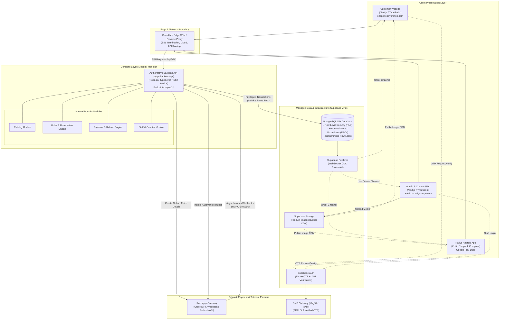
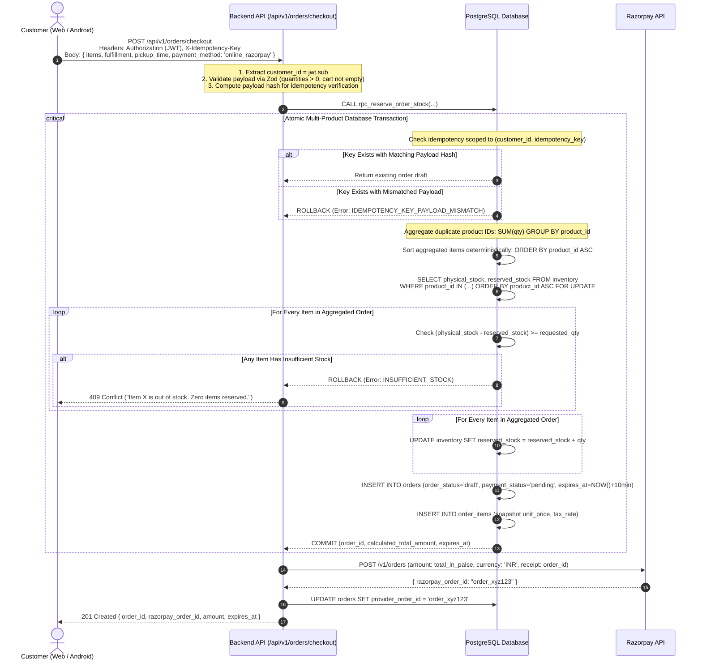
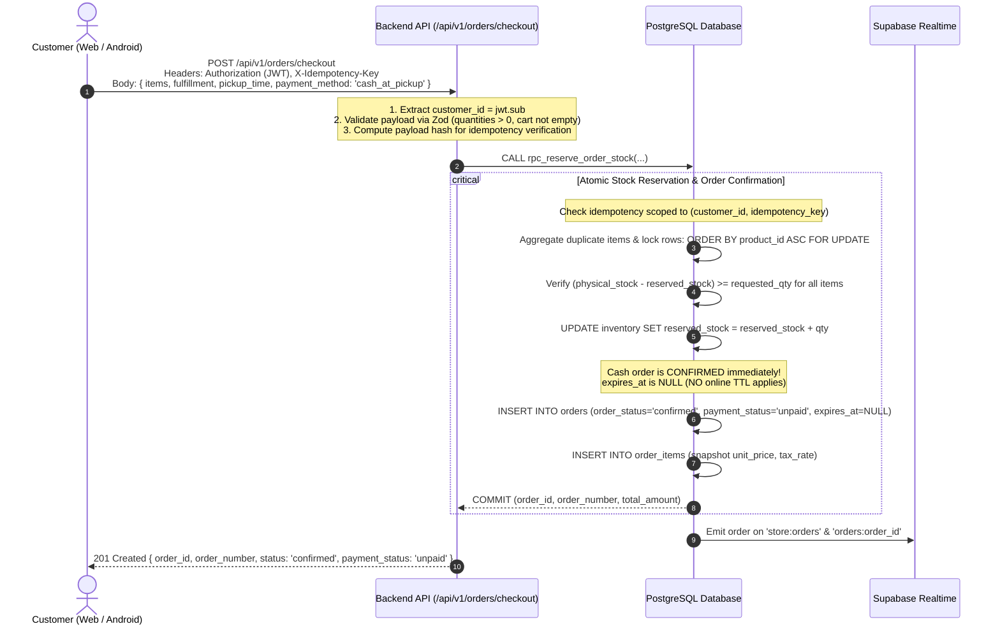
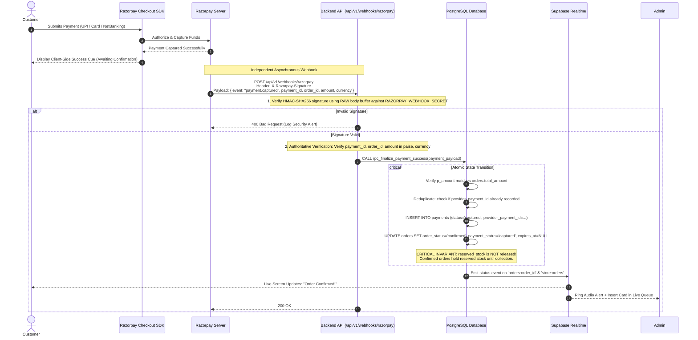
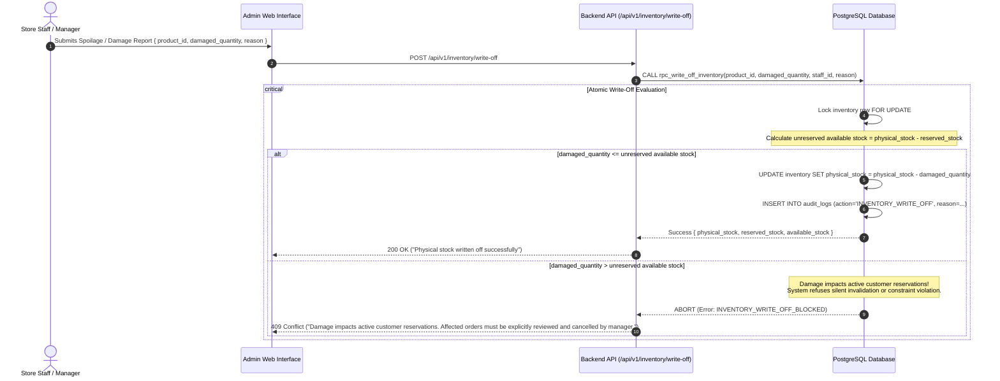

# Moody Orange — System Architecture Specification

**Document Version:** 1.4.1 (Phase 0.4.1 Final Blocker Resolution)  
**Phase:** Phase 0 (Requirements & Architecture)  
**Status:** Ready for Phase 0 Approval Review  
**Target System:** Moody Orange Unified Ordering Platform  
**Repository:** [https://github.com/AbhinavKumar36/orange](https://github.com/AbhinavKumar36/orange)  

---

## Revision History

| Version | Date | Author | Description of Changes |
| :--- | :--- | :--- | :--- |
| **1.0.0** | 2026-10-30 | Lead Architect | Initial architectural proposal with embedded Next.js API. |
| **1.1.0** | 2026-10-30 | Lead Architect | Phase 0.1 Revision: Decoupled standalone Backend API modular monolith (`apps/backend-api`). |
| **1.2.0** | 2026-10-30 | Lead Architect | Phase 0.2 Revision: Standardized `physical_stock` and multi-product deterministic row locks. |
| **1.3.0** | 2026-10-30 | Lead Architect | Phase 0.3 Consistency Pass: Scoped idempotency keys, hardened DB functions, RLS matrix. |
| **1.4.0** | 2026-10-30 | Lead Architect | Phase 0.4 Consistency Pass: State transition matrix, race condition resolution, refund recovery. |
| **1.4.1** | 2026-10-30 | Lead Architect | **Phase 0.4.1 Final Blocker Resolution:**<br>• Fully separated Online Checkout (`draft`, `pending`, TTL) from Cash-at-Pickup (`confirmed`, `unpaid`, `expires_at = NULL`).<br>• Documented that cash orders cannot be expired by the online checkout reservation worker.<br>• Added Flow 4: Protected Inventory Write-Off and Spoilage Management (`physical_stock >= reserved_stock`).<br>• Refined late-payment recovery decision tree and partial refund concurrency controls. |

---

## 1. Architectural Strategy & Evaluation

### 1.1 Core Architectural Principles
1. **Single Authoritative Source of Truth:** `[CONFIRMED]` All business calculations, prices, stock balances, taxes, and order state progressions are enforced strictly on the server and database. Client applications are presentation layers with zero authority to dictate prices or stock.
2. **Zero-Trust Client Inputs:** `[CONFIRMED]` The backend never accepts client-calculated totals, arbitrary payment confirmation signals, or client-asserted customer IDs. Customer identity is derived strictly from verified JWT `sub`.
3. **Atomic Multi-Product Concurrency Guarantee:** `[CONFIRMED]` Inventory reservations aggregate duplicate items, validate all quantities, lock rows in deterministic ascending order (`ORDER BY product_id ASC FOR UPDATE`) to eliminate deadlocks, and allocate stock on an all-or-nothing basis.
4. **Distinct Payment Method Lifecycles:** `[CONFIRMED]` Online payments and Cash at Pickup operate under distinct state pipelines. Cash orders are accepted immediately, hold reservations without an online TTL, and require counter cash confirmation prior to completion.
5. **Asynchronous Webhook-First Settlement & Evidence-Based Refunds:** `[CONFIRMED]` Payment capture and refunds are confirmed exclusively via cryptographically signed webhooks and direct gateway evidence, never client-side redirects alone.
6. **Independent Backend Separation:** `[CONFIRMED ARCHITECTURE]` The backend API is logically and deployably independent from both the customer-facing and admin-facing web applications.

---

## 2. High-Level System Architecture Topology



---

## 3. Server-Side Authorization Architecture

Because the Backend API communicates with Supabase using the Service Role key (which deliberately bypasses PostgreSQL RLS), **the Backend API middleware acts as the authoritative security enforcement gateway**:

```
[ Incoming HTTP Request ]
          │
          ▼
   [ 1. Authenticate JWT ]
   Validate Supabase JWT via cryptographic signature (ES256 / HS256)
   └── (Invalid / Missing / Expired) ──► HTTP 401 Unauthorized
          │
          ▼
   [ 2. Extract Caller Identity ]
   Identity = jwt.sub (UUID). NEVER accept customer_id from request body or query params.
          │
          ▼
   [ 3. Authorize Role & Resource Ownership ]
     ├─► Customer Route: Ensure target resource belongs to caller:
     │     SELECT 1 FROM orders WHERE id = :order_id AND customer_id = :jwt_sub
     │     └── Not Owner ──► HTTP 403 Forbidden
     │
     └─► Staff Route: Query public.staff_roles for :jwt_sub:
           SELECT role FROM staff_roles WHERE user_id = :jwt_sub AND is_active = true
           └── Lacks Required Role ──► HTTP 403 Forbidden
          │
          ▼
   [ 4. Input Validation & Customer-Scoped Idempotency Check ]
   Validate Zod schema; compute canonical payload hash; scope idempotency key to jwt.sub
          │
          ▼
   [ 5. Execute Privileged Database Transaction / RPC ]
```

---

## 4. End-to-End Data Flows

### 4.1 Flow 1A: Online Payment Checkout & Reservation (Razorpay)



---

### 4.1 Flow 1B: Cash-at-Pickup Checkout (Accepted Immediately)



---

### 4.2 Flow 2: Razorpay Payment Settlement & Authoritative Verification



---

### 4.3 Flow 2B: Late Webhook Arrival & Evidence-Based Refund Lifecycle

```mermaid
sequenceDiagram
    autonumber
    participant RP as Razorpay Server
    participant WebhookAPI as Backend API (/api/v1/webhooks/razorpay)
    participant DB as PostgreSQL Database
    participant RP_API as Razorpay Refunds API
    participant RT as Supabase Realtime

    RP->>WebhookAPI: POST /api/v1/webhooks/razorpay (event: payment.captured for Expired Order A)
    Note over WebhookAPI: Verify HMAC Signature, Order ID, Amount, Currency (Valid)
    
    WebhookAPI->>DB: CALL rpc_reconcile_late_payment(...)
    critical Atomic Reconciliation Evaluation
        DB->>DB: Lock order row FOR UPDATE; verify status is 'cancelled_expired'
        DB->>DB: Lock inventory rows for Order A deterministically: ORDER BY product_id ASC FOR UPDATE
        Note over DB: Check if (physical_stock - reserved_stock) >= Order A items
        alt Inventory IS Still Available for ALL Items
            DB->>DB: Re-reserve stock: reserved_stock = reserved_stock + qty
            DB->>DB: UPDATE orders SET order_status = 'confirmed', payment_status = 'captured', expires_at = NULL
            DB-->>WebhookAPI: Status: CONFIRMED_REALLOCATED
        else Inventory IS NOT Available (Depleted)
            DB->>DB: INSERT INTO payments (status='refund_pending', provider_payment_id=...)
            DB->>DB: UPDATE orders SET order_status = 'cancelled_inventory_depleted', payment_status = 'refund_pending'
            DB-->>WebhookAPI: Status: INSUFFICIENT_STOCK_TRIGGER_REFUND
        end
    end

    alt Inventory Reallocated
        WebhookAPI-->>RP: 200 OK
        DB->>RT: Push "Confirmed" to customer and admin
    else Inventory Depleted (Evidence-Based Refund Workflow)
        Note over WebhookAPI: Step 1: Request Refund from Razorpay with Deterministic Idempotency Key
        WebhookAPI->>RP_API: POST /v1/payments/{payment_id}/refund<br/>Headers: X-Refund-Idempotency-Key: rfnd_<payment_id>_<refund_uuid>
        alt Network Timeout / Gateway HTTP 5xx
            Note over WebhookAPI: DO NOT retry blindly. Poll Razorpay GET /v1/payments/{payment_id}/refunds using idempotency key
        else HTTP 200 Received
            RP_API-->>WebhookAPI: HTTP 200 { id: "rfnd_123", status: "processed" }
            Note over WebhookAPI: Step 2: Gateway acceptance sets 'refund_processing', NOT 'refunded'!
            WebhookAPI->>DB: INSERT INTO refunds (provider_refund_id, status='refund_processing', idempotency_key=...)
            WebhookAPI->>DB: UPDATE orders SET payment_status = 'refund_processing'
            WebhookAPI-->>RP: 200 OK
        end

        Note over RP,WebhookAPI: Step 3: Asynchronous Gateway Confirmation Webhook
        RP->>WebhookAPI: POST /api/v1/webhooks/razorpay (event: refund.processed)
        WebhookAPI->>DB: UPDATE refunds SET status = 'refunded'
        WebhookAPI->>DB: UPDATE orders SET payment_status = 'refunded'
        DB->>RT: Notify Customer: "Refund completed to original payment method."
        WebhookAPI-->>RP: 200 OK
    end
```

---

### 4.4 Flow 3: Counter Collection & Physical Stock Decrement

```mermaid
sequenceDiagram
    autonumber
    actor Customer as Customer (At Counter)
    actor Staff as Counter Staff (Admin Web)
    participant AdminUI as Admin Web Interface
    participant API as Backend API (/api/v1/staff/orders)
    participant DB as PostgreSQL Database
    participant RT as Supabase Realtime

    Customer->>Staff: Identifies Order (Presents PIN / QR / Order Number)
    Staff->>AdminUI: Enters Token or Scans QR in Handover Modal
    AdminUI->>API: POST /api/v1/staff/orders/verify { token: "..." }
    API->>DB: SELECT * FROM orders WHERE id = ... AND order_status = 'ready_for_pickup'
    DB-->>API: Return order details and payment status
    API-->>AdminUI: Render Order Verification Modal

    alt Order is Cash at Pickup (payment_status = 'unpaid')
        AdminUI->>Staff: Prompt: "COLLECT CASH: ₹X.XX"
        Staff->>Customer: Collects Cash and places in cash register
        Staff->>AdminUI: Checks box: [x] "Cash Received in Register" & Clicks "Complete"
        AdminUI->>API: POST /api/v1/staff/orders/complete { order_id, cash_collected: true }
        critical Commit Cash Payment and Physical Stock Decrement
            Note over API,DB: CALL rpc_complete_order_handover(order_id, staff_id, cash_collected=true)
            DB->>DB: Lock order row FOR UPDATE; assert order_status = 'ready_for_pickup'
            DB->>DB: Assert cash_collected=true; record payment in payments (status='captured')
            DB->>DB: Lock inventory rows: ORDER BY product_id ASC FOR UPDATE
            DB->>DB: UPDATE orders SET order_status='completed', payment_status='captured', collected_at=NOW()
            DB->>DB: UPDATE inventory SET physical_stock = physical_stock - qty, reserved_stock = reserved_stock - qty
        end
    else Order is Prepaid Online (payment_status = 'captured')
        Staff->>AdminUI: Clicks "Handover & Complete"
        AdminUI->>API: POST /api/v1/staff/orders/complete { order_id }
        critical Commit Physical Stock Decrement
            Note over API,DB: CALL rpc_complete_order_handover(order_id, staff_id, cash_collected=false)
            DB->>DB: Lock order row FOR UPDATE; assert payment_status = 'captured'
            DB->>DB: Lock inventory rows: ORDER BY product_id ASC FOR UPDATE
            DB->>DB: UPDATE orders SET order_status='completed', collected_at=NOW()
            DB->>DB: UPDATE inventory SET physical_stock = physical_stock - qty, reserved_stock = reserved_stock - qty
        end
    end

    DB->>RT: Broadcast order_status = 'completed'
    RT-->>Customer: Screen updates: "Order Completed. Thank you for visiting!"
    AdminUI-->>Staff: Card moves to "Completed Today"
```

---

### 4.5 Flow 4: Protected Inventory Write-Off & Damage Management



---

## 5. Order & Inventory Lifecycle State Machine

### 5.1 Authoritative State Transition Matrix

The table below defines every valid order lifecycle state transition, distinguishing Online Checkout from Cash-at-Pickup:

| Transition Event | Payment Method | Source `order_status` | Target `order_status` | Source $\rightarrow$ Target `payment_status` | Inventory Impact (`physical_stock`, `reserved_stock`) | Defensive Invariants Enforced |
| :--- | :--- | :--- | :--- | :--- | :--- | :--- |
| **1. Online Reservation Creation** | `online_razorpay` | `(none)` | `draft` | `(none)` $\rightarrow$ `pending` | `physical_stock` unchanged<br>`reserved_stock += qty` | Empty cart rejected; quantities positive; duplicate products aggregated; rows locked `ORDER BY product_id ASC FOR UPDATE`; `expires_at = NOW() + 10m`. |
| **2. Cash Checkout Creation** | `cash_at_pickup` | `(none)` | `confirmed` | `(none)` $\rightarrow$ `unpaid` | `physical_stock` unchanged<br>`reserved_stock += qty` | Accepted immediately. `expires_at = NULL` (NO online TTL applies). Holds reserved stock for pickup. |
| **3. Online Payment Success** | `online_razorpay` | `draft` | `confirmed` | `pending` $\rightarrow$ `captured` | **Unchanged!** (`reserved_stock` remains reserved) | Webhook raw HMAC verified; amount and currency verified; `expires_at = NULL`. Reservation retained! |
| **4. Online Payment Failure** | `online_razorpay` | `draft` | `draft` (retryable) | `pending` $\rightarrow$ `failed` | Unchanged | Customer can retry payment until `expires_at`. Stock released only if TTL expires or order cancelled. |
| **5. Online Reservation Expiration** | `online_razorpay` | `draft` | `cancelled_expired` | `pending` $\rightarrow$ `expired` | `physical_stock` unchanged<br>`reserved_stock -= qty` exactly once | Expiration worker targets ONLY `order_status = 'draft' AND payment_method = 'online_razorpay' AND expires_at < NOW()`. Cash orders are immune! |
| **6. Late Payment (Stock Available)** | `online_razorpay` | `cancelled_expired`| `confirmed` | `expired` $\rightarrow$ `captured` | `physical_stock` unchanged<br>`reserved_stock += qty` | Safe recovery: Locks inventory rows; verifies stock is available AND operational window is valid before reviving order. |
| **7. Late Payment (Stock Depleted)** | `online_razorpay` | `cancelled_expired`| `cancelled_inventory_depleted` | `expired` $\rightarrow$ `refund_pending` $\rightarrow$ `refund_processing` | Unchanged (Zero inventory allocated) | Never revives expired order if stock depleted. Immediately initiates gateway refund with stable idempotency key. |
| **8. Customer Cancellation** | Either | `draft` or `confirmed` | `cancelled_by_customer` | `pending` or `captured` $\rightarrow$ `refund_pending` (if online); `unpaid` $\rightarrow$ `failed` (if cash) | `physical_stock` unchanged<br>`reserved_stock -= qty` exactly once | Allowed only while `draft` or `confirmed` (prior to kitchen transitioning to `preparing`). |
| **9. Cash Handover Collection** | `cash_at_pickup` | `ready_for_pickup` | `completed` | `unpaid` $\rightarrow$ `captured` | `physical_stock -= qty`<br>`reserved_stock -= qty` atomically | Handover BLOCKED unless staff explicitly confirms cash receipt (`p_cash_collected IS TRUE`). Cannot be completed twice. |
| **10. Online Order Handover** | `online_razorpay` | `ready_for_pickup` | `completed` | `captured` $\rightarrow$ `captured` | `physical_stock -= qty`<br>`reserved_stock -= qty` atomically | Verifies `payment_status = 'captured'` and customer collection token before handover. Cannot be completed twice. |
| **11. Unreserved Stock Write-Off** | N/A | N/A | N/A | N/A | `physical_stock -= damaged_qty`<br>`reserved_stock` unchanged | Permitted only when `damaged_qty <= available_stock`. Preserves `physical_stock >= reserved_stock`. |
| **12. Reserved Stock Damage Incident**| Either | `confirmed` / `preparing` | `cancelled_damaged_stock` | If online: `refund_pending` $\rightarrow$ `refund_processing`<br>If cash: `unpaid` $\rightarrow$ `failed` | `reserved_stock -= order.qty`<br>Then `physical_stock -= damaged_qty` | Manager explicitly cancels affected order(s) before writing off damaged physical items. Customer refunded and notified. |

---

## 6. Concurrency Control & Race Condition Resolution Matrix

| Race Condition Scenario | Competing Operations | Concurrency Risk | Resolution Mechanism |
| :--- | :--- | :--- | :--- |
| **A. Online Expiration Worker vs. Cash Order** | Scheduled background worker runs cleanup while active Cash-at-Pickup orders exist in database. | Cash order accidentally cancelled after 10 minutes, releasing reservation while customer is travelling to store. | **Strict Query Isolation & Constraint:**<br>1. `orders.chk_cash_no_online_expiry` guarantees `expires_at IS NULL` for all cash orders.<br>2. `rpc_release_expired_reservations` explicitly queries `WHERE order_status = 'draft' AND payment_method = 'online_razorpay' AND expires_at < NOW()`. Cash orders are mathematically excluded. |
| **B. Expiration Worker vs. Payment Webhook** | Background worker marks online order expired while Razorpay `payment.captured` webhook arrives simultaneously. | Order cancelled while payment is captured, or stock freed and double-allocated. | **Safe Late-Payment Reconciler (`rpc_reconcile_late_payment`):**<br>1. Acquires row lock on `orders` and `inventory` using `ORDER BY product_id ASC FOR UPDATE`.<br>2. If expiration worker commits first, webhook calls `rpc_reconcile_late_payment`. If stock remains available and pickup time is valid, it re-reserves stock and confirms order. If stock was claimed by another customer, order remains cancelled and gateway refund is dispatched with stable idempotency key.<br>3. If webhook commits first, `order_status` becomes `'confirmed'` and `expires_at` is cleared. When expiration worker runs, it skips the order because `order_status != 'draft'`. |
| **C. Staff Damage Write-Off vs. Active Reservations** | Staff reports damaged goods when units are reserved for confirmed customer orders. | `physical_stock` reduced below `reserved_stock` (database check constraint failure), or customer reservation silently invalidated. | **Protected Write-Off Invariant (`rpc_write_off_inventory`):**<br>1. Locks inventory row `FOR UPDATE`. Calculates `available = physical_stock - reserved_stock`.<br>2. If damage $\le$ available, decrements `physical_stock` safely.<br>3. If damage $>$ available, write-off is blocked. Manager must review dispatch queue and explicitly cancel the affected order(s) via `rpc_cancel_order('damaged_stock')`. This frees `reserved_stock` and triggers customer refund, after which the physical write-off succeeds without violating invariants. |
| **D. Counter Handover vs. Cancellation / Collection Replay** | Staff clicks "Complete" twice, or customer attempts late cancellation during counter handover. | Handover completed twice, inventory decremented twice, or cancelled order handed over. | **Handover Lock Serialization (`rpc_complete_order_handover`):**<br>1. Locks order `FOR UPDATE`. Asserts `order_status = 'ready_for_pickup'`. If already `'completed'`, aborts immediately.<br>2. For cash orders, asserts `p_cash_collected IS TRUE`.<br>3. For online orders, asserts `payment_status = 'captured'`.<br>4. Decrements `physical_stock` and `reserved_stock` atomically. Replay attempts fail immediately. |
| **E. Concurrent Multi-Product Checkouts** | Customer A orders [Cake 1, Juice 1] while Customer B orders [Juice 1, Cake 1]. | Database deadlock between simultaneous row lock acquisitions. | **Deterministic Ordering:** All checkout, cancellation, late payment, and handover procedures sort unique `product_id` values in ascending order prior to executing `SELECT ... FOR UPDATE`. Deadlocks are eliminated. |
| **F. Partial Refund Concurrency & Cumulative Limit** | Staff initiates two partial refunds concurrently on the same captured order. | Cumulative refunds exceed captured payment amount. | **Payment Row Locking & Cap Assertion (`rpc_issue_refund`):**<br>1. Locks `payments` row `FOR UPDATE`.<br>2. Computes `remaining = payment.amount - SUM(active refunds)`.<br>3. If `requested > remaining`, transaction aborts with `REFUND_EXCEEDS_REMAINING_AMOUNT`. |
| **G. Refund Gateway Network Timeout** | Backend API calls Razorpay Refunds API, but request times out or returns HTTP 504. | Backend retries blindly and creates duplicate provider refunds. | **Stable Idempotency Keys:** Every refund dispatch uses a deterministic idempotency key (`rfnd_<payment_id>_<refund_uuid>`). On timeout, refund remains in `refund_pending`. A reconciliation worker queries `GET /v1/payments/{payment_id}/refunds` using the idempotency key to verify provider state before retrying. |
