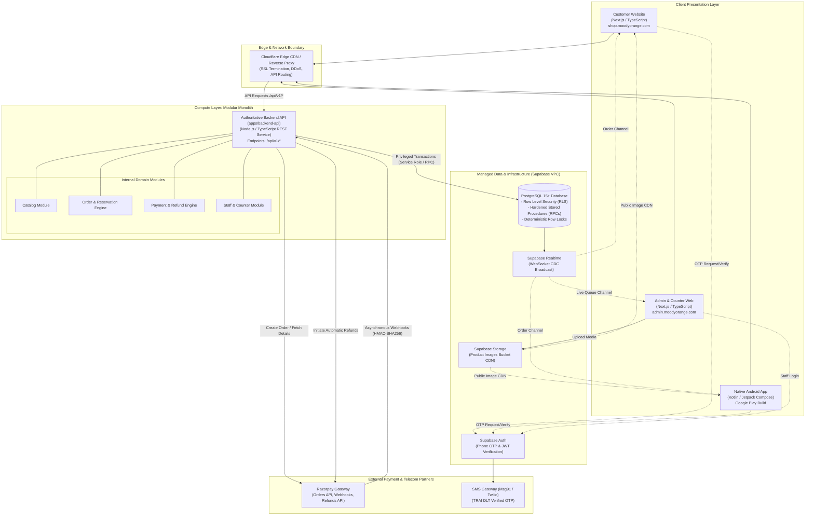
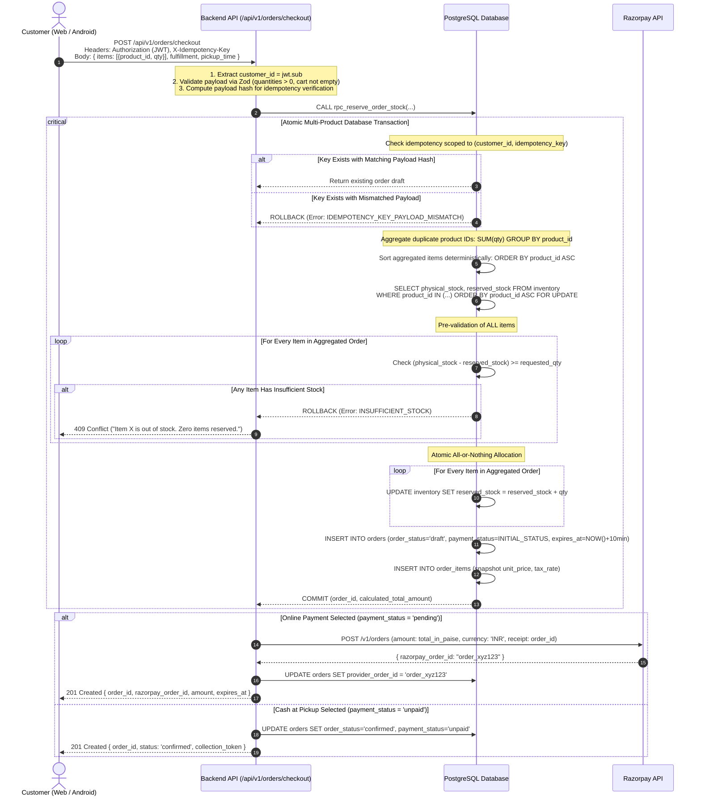
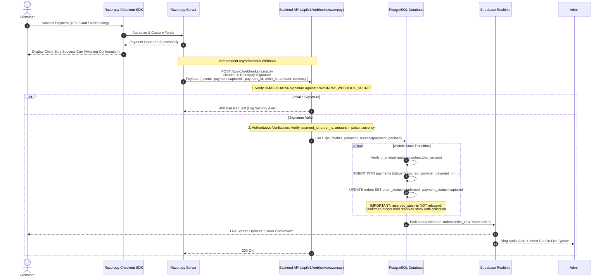
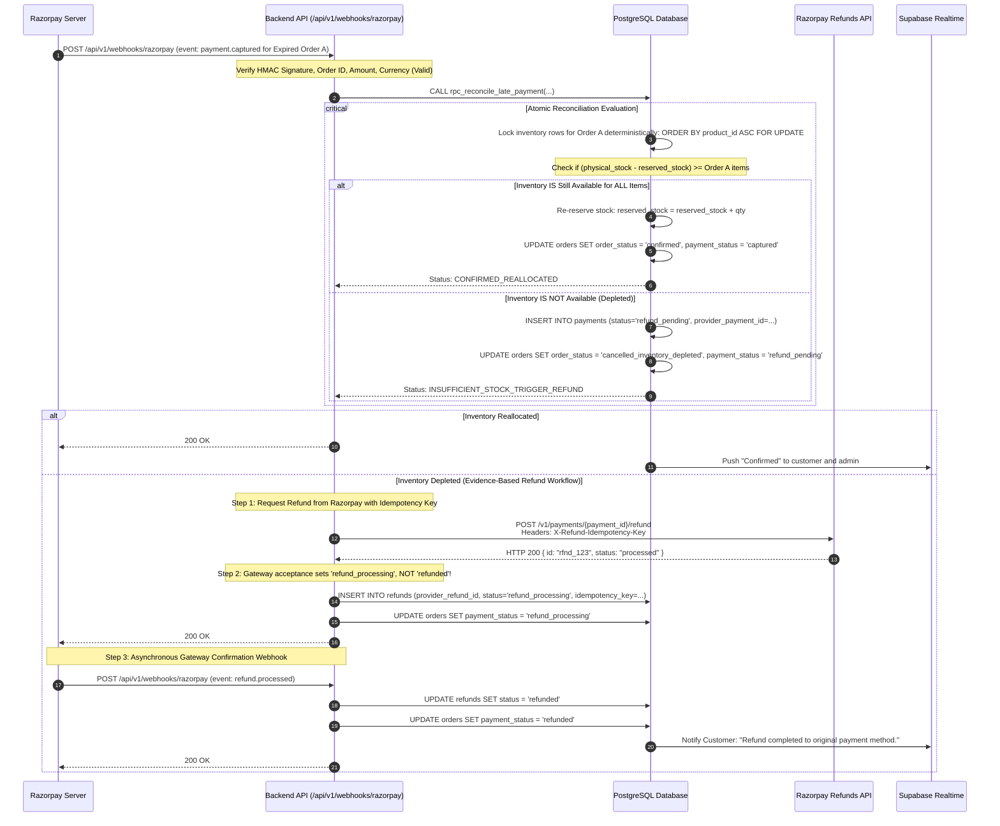
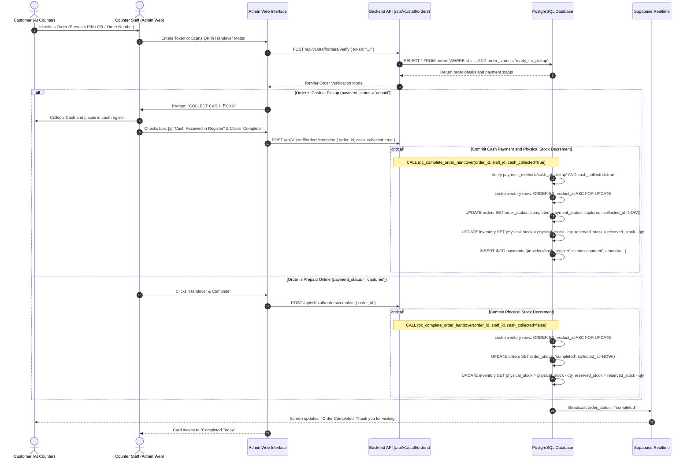

# Moody Orange — System Architecture Specification

**Document Version:** 1.3.0 (Phase 0.3 Final Consistency Pass)  
**Phase:** Phase 0 (Requirements & Architecture)  
**Status:** Pending Client Review & Sign-Off  
**Target System:** Moody Orange Unified Ordering Platform  
**Repository:** [https://github.com/AbhinavKumar36/orange](https://github.com/AbhinavKumar36/orange)  

---

## Revision History

| Version | Date | Author | Description of Changes |
| :--- | :--- | :--- | :--- |
| **1.0.0** | 2026-10-30 | Lead Architect | Initial architectural proposal with embedded Next.js API. |
| **1.1.0** | 2026-10-30 | Lead Architect | Phase 0.1 Revision: Decoupled standalone Backend API modular monolith (`apps/backend-api`). |
| **1.2.0** | 2026-10-30 | Lead Architect | Phase 0.2 Revision: Standardized `physical_stock` and multi-product deterministic row locks. |
| **1.3.0** | 2026-10-30 | Lead Architect | **Phase 0.3 Final Consistency Pass:**<br>• Hardened Flow 1 data flow: aggregated duplicate product IDs, validated positive quantities, scoped idempotency keys to customer with payload hash.<br>• Separated Cash-at-Pickup (`unpaid` state) from online payment gateway states; prevented cash order completion without verified cash receipt.<br>• Enforced deterministic `ORDER BY product_id ASC FOR UPDATE` locking across all inventory procedures.<br>• Documented authoritative Razorpay payment validation prior to DB procedure invocation.<br>• Formalized evidence-based refund state progression (`refund_pending` -> `refund_processing` -> `refunded`). |

---

## 1. Architectural Strategy & Evaluation

### 1.1 Core Architectural Principles
1. **Single Authoritative Source of Truth:** `[CONFIRMED]` All business calculations, prices, stock balances, taxes, and order state progressions are enforced strictly on the server and database. Client applications are presentation layers with zero authority to dictate prices or stock.
2. **Zero-Trust Client Inputs:** `[CONFIRMED]` The backend never accepts client-calculated totals, arbitrary payment confirmation signals, or client-asserted customer IDs. Customer identity is derived strictly from verified JWT `sub`.
3. **Atomic Multi-Product Concurrency Guarantee:** `[CONFIRMED]` Inventory reservations lock rows in deterministic ascending order (`ORDER BY product_id ASC`) to eliminate deadlocks, and pre-validate all line items before allocating stock on an all-or-nothing basis.
4. **Asynchronous Webhook-First Settlement & Evidence-Based Refunds:** `[CONFIRMED]` Payment capture and refunds are confirmed exclusively via cryptographically signed webhooks and direct gateway evidence, never client-side redirects alone.
5. **Independent Backend Separation:** `[CONFIRMED ARCHITECTURE]` The backend API is logically and deployably independent from both the customer-facing and admin-facing web applications.

---

## 2. High-Level System Architecture Topology



---

## 3. Server-Side Authorization Architecture

Because the Backend API communicates with Supabase using the Service Role key (which deliberately bypasses PostgreSQL RLS), **the Backend API middleware must act as the authoritative security enforcement gateway**:

```
[ Incoming HTTP Request ]
          │
          ▼
   [ 1. Authenticate JWT ]
   Validate Supabase JWT via cryptographic signature (ES256 / HS256)
   └── (Invalid / Missing / Expired) ──► HTTP 401 Unauthorized
          │
          ▼
   [ 2. Extract Caller Identity ]
   Identity = jwt.sub (UUID). NEVER accept customer_id from request body or query params.
          │
          ▼
   [ 3. Authorize Role & Resource Ownership ]
     ├─► Customer Route: Ensure target resource belongs to caller:
     │     SELECT 1 FROM orders WHERE id = :order_id AND customer_id = :jwt_sub
     │     └── Not Owner ──► HTTP 403 Forbidden
     │
     └─► Staff Route: Query public.staff_roles for :jwt_sub:
           SELECT role FROM staff_roles WHERE user_id = :jwt_sub AND is_active = true
           └── Lacks Required Role ──► HTTP 403 Forbidden
          │
          ▼
   [ 4. Input Validation & Customer-Scoped Idempotency Check ]
   Validate Zod schema; compute canonical payload hash; scope idempotency key to jwt.sub
          │
          ▼
   [ 5. Execute Privileged Database Transaction / RPC ]
```

---

## 4. End-to-End Data Flows

### 4.1 Flow 1: Multi-Product Order Placement & Deterministic Stock Reservation



---

### 4.2 Flow 2: Razorpay Payment Settlement & Authoritative Verification



---

### 4.3 Flow 2B: Late Webhook Arrival & Evidence-Based Refund Lifecycle



---

### 4.4 Flow 3: Counter Collection & Physical Stock Decrement


